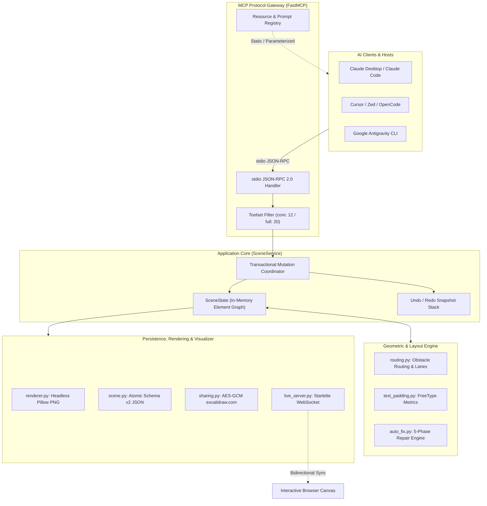
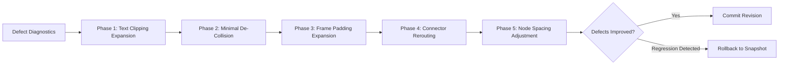

<div align="center">

# Excalidraw MCP Server

**A headless, in-memory Model Context Protocol server enabling AI agents to programmatically generate, inspect, repair, and export native Excalidraw diagrams.**

[](https://github.com/Dharshan2208/excalidraw-mcp/blob/main/LICENSE)
[](https://pypi.org/project/exca-mcp/)
[](https://www.python.org/)
[](https://github.com/Dharshan2208/excalidraw-mcp/actions)
[](https://github.com/Dharshan2208/excalidraw-mcp/stargazers)

</div>

---

## What is this?

**Excalidraw MCP** is a backend-oriented Model Context Protocol (MCP) server that empowers AI coding agents to create, inspect, edit, diagnose, and export native [Excalidraw](https://excalidraw.com) diagrams over standard `stdio`. Operating directly on scene graphs and element trees in memory with FreeType font metrics and topological collision solvers, it completely bypasses headless browser automation to achieve sub-millisecond diagram mutations. All diagrams serialize strictly to Excalidraw Schema v2 JSON, guaranteeing immediate, native compatibility with excalidraw.com, IDE plugins, and high-resolution export pipelines.

---

## Visual Showcase


*Figure 1: Complete multi-tier architecture diagram generated programmatically by Excalidraw MCP itself. Editable source file: [docs/architecture.excalidraw](docs/architecture.excalidraw).*

### Automated Layout Repair Engine (`auto_fix_layout`)

Excalidraw MCP incorporates a deterministic layout diagnostic and repair engine that automatically resolves overlapping nodes, text clipping, and crowded boundaries without human intervention:

| Before Auto-Fix (Overlapping & Misaligned Nodes) | After Auto-Fix (Repaired Clearances & Route Segments) |
|---|---|
|  |  |

---

## Quick Start

Get Excalidraw MCP running in under 60 seconds using [`uvx`](https://docs.astral.sh/uv/) (zero install required):

```bash
# Run the published server instantly via stdio
uvx exca-mcp
```

Or install into a virtual environment with `pip`:

```bash
pip install exca-mcp
python -m excalidraw_mcp
```

### Minimal 4-Step Diagram Workflow

When connected to an AI agent (Claude Desktop, Cursor, Zed, OpenCode, Claude Code, or Antigravity), the agent can construct, repair, and preview diagrams using the default `core` toolset:

```python
# 1. Create container boundary frame
f = add_frame(name="Application Tier", x=100, y=100, w=600, h=220)

# 2. Add styled components inside the frame
s1 = create_shape(type="rectangle", x=140, y=160, w=180, h=90, label="API Gateway", frame_id=f["frame_id"], backgroundColor="#e7f5ff")
s2 = create_shape(type="rectangle", x=460, y=160, w=180, h=90, label="Auth Service", frame_id=f["frame_id"], backgroundColor="#fff3bf")

# 3. Connect components with an elbowed directional connector
create_connector(source_id=s1["rectangle_id"], target_id=s2["rectangle_id"], label="verify_token()", elbowed=True)

# 4. Diagnose layout defects and render an inline visual preview
auto_fix_layout(dry_run=False, aggressiveness="balanced")
preview(max_dimension=1568, format="png")
```

---

## Table of Contents

- [What is this?](#what-is-this)
- [Visual Showcase](#visual-showcase)
- [Quick Start](#quick-start)
- [Key Features](#key-features)
- [System Architecture](#system-architecture)
- [Installation](#installation)
- [MCP Client Configuration](#mcp-client-configuration)
- [Toolset Profiles & Token Optimization](#toolset-profiles--token-optimization)
- [MCP Tools Reference](#mcp-tools-reference)
  - [Core Profile Tools (12 Tools — Default)](#1-core-profile-tools-12-tools--default)
  - [Full Profile Tools (8 Tools — 20 Total)](#2-full-profile-tools-8-additional-tools--20-total)
- [MCP Resources & Prompts](#mcp-resources--prompts)
- [Bundled Agent Skills](#bundled-agent-skills)
- [End-to-End Agent Workflows](#end-to-end-agent-workflows)
- [Configuration & Environment Variables](#configuration--environment-variables)
- [Interactive Live Canvas Server](#interactive-live-canvas-server)
- [Security & Sandboxing](#security--sandboxing)
- [Limitations & Troubleshooting](#limitations--troubleshooting)
- [Development & Testing](#development--testing)
- [Documentation](#documentation)
- [License](#license)

---

## Key Features

- **Headless In-Memory Operations**: Operates 100% in pure Python on scene graphs in server memory. Zero reliance on Puppeteer, Playwright, Chromium, or Node.js runtimes. Sub-millisecond execution speeds suitable for agent loops.
- **Native Excalidraw Schema v2**: Outputs fully valid, editable `.excalidraw` JSON documents that open directly on [excalidraw.com](https://excalidraw.com) and in Excalidraw IDE extensions without loss of fidelity.
- **Obstacle-Aware Orthogonal Routing**: Calculates Manhattan arrow paths around intervening bounding boxes with configurable 15 px clearance corridors and dynamic cardinal-face docking ports.
- **Parallel Multi-Edge Lane Assignment**: Detects multiple connectors between the same shapes and assigns distinct 24 px lane offsets to eliminate overlapping line segments.
- **Font-Aware Text Metrics & Inscribed Containment**: Uses FreeType and Pillow to measure exact typographic envelopes, preventing label clipping inside rectangles, rhombuses, and ellipses.
- **5-Phase Automated Layout Repair (`auto_fix_layout`)**: Detects bounding box collisions, text clipping, and frame escapes, executing deterministic de-collision and spacing phases with transactional regression rollback.
- **Atomic Multi-Operation Batching (`batch_mutate`)**: Promoted to the default profile, enabling agents to create, move, style, connect, lock, group, and repair up to 500 operations in a single roundtrip with dynamic `client_id` resolution.
- **Halved Schema Context Footprint**: Minimalist tool contracts and compact minified JSON responses strip `outputSchema` overhead, reducing turn context usage by up to 50.4% (5,048 tokens for `core` vs 7,937 for `full`).
- **High-Resolution Headless Export**: Headless Pillow rasterization generating PNG exports up to 8192 px and inline vision previews (`preview`) capped to optimal model envelopes (`max_dimension=1568`).
- **Real-Time Live Canvas (`live_server`)**: Optional background Starlette/Uvicorn WebSocket visualizer synchronizing agent tool mutations live to an open browser tab.
- **Client-Side Encrypted Cloud Sharing (`export_to_excalidraw_url`)**: Publishes scenes directly to excalidraw.com using 128-bit AES-GCM client-side encryption, returning instantaneous shareable links.
- **Six Bundled Agent Skills**: Packages prompt and pattern guides covering architecture design, flowcharts, 60-30-10 color palettes, and quality gates, installable via `exca-mcp install-skills`.

---

## System Architecture

Excalidraw MCP functions as an in-memory mediator between AI coding assistants, file systems, and web browsers.

### Internal Subsystem Workflow



### 5-Phase Automated Layout Repair Engine

The layout repair engine (`auto_fix_layout`) operates across five deterministic phases with an automated regression rollback guard:



For full architecture details and algorithmic specifications, see [docs/ARCHITECTURE.md](docs/ARCHITECTURE.md).

---

## Installation

### Method 1: `uvx` (Recommended Zero-Install)

Run without prior installation. `uvx` executes the package in an ephemeral, isolated environment:

```bash
uvx exca-mcp
```

### Method 2: `pip`

Install into any Python 3.12+ environment:

```bash
pip install exca-mcp
python -m excalidraw_mcp
```

### Method 3: Docker Container

Run containerized over standard input/output (`-i` interactive mode required for stdio transport):

```bash
# Build the image locally
docker build -t exca-mcp .

# Run the MCP server over stdio
docker run -i --rm exca-mcp
```

### Method 4: Clone & Run from Source

```bash
git clone https://github.com/Dharshan2208/excalidraw-mcp.git
cd excalidraw-mcp
uv sync --locked
uv run exca-mcp
```

---

## MCP Client Configuration

Add Excalidraw MCP to your AI environment by adding the server configuration snippet below.

### Claude Desktop

Edit your `claude_desktop_config.json` (macOS: `~/Library/Application Support/Claude/claude_desktop_config.json`, Windows: `%APPDATA%\Claude\claude_desktop_config.json`, Linux: `~/.config/Claude/claude_desktop_config.json`):

```json
{
  "mcpServers": {
    "excalidraw": {
      "command": "uvx",
      "args": ["exca-mcp"]
    }
  }
}
```

*To enable the complete 20-tool profile in Claude Desktop:*

```json
{
  "mcpServers": {
    "excalidraw": {
      "command": "uvx",
      "args": ["exca-mcp"],
      "env": {
        "EXCALIDRAW_TOOLSET": "full"
      }
    }
  }
}
```

### Cursor

Add to your project's `.cursor/mcp.json` or Global MCP Settings:

```json
{
  "mcpServers": {
    "excalidraw": {
      "command": "uvx",
      "args": ["exca-mcp"]
    }
  }
}
```

### Zed

Add to `~/.config/zed/settings.json`:

```json
{
  "context_servers": {
    "excalidraw": {
      "command": {
        "path": "uvx",
        "args": ["exca-mcp"]
      }
    }
  }
}
```

### OpenCode

Add to `opencode.json` or `~/.config/opencode/config.json`:

```json
{
  "mcp": {
    "excalidraw": {
      "type": "local",
      "command": ["uvx", "exca-mcp"]
    }
  }
}
```

### Claude Code CLI

Add Excalidraw MCP via the command line:

```bash
claude mcp add excalidraw uvx exca-mcp
```

### Google Antigravity / Gemini CLI

Add to your repository's root `mcp.json`:

```json
{
  "mcpServers": {
    "excalidraw": {
      "command": "uvx",
      "args": ["exca-mcp"]
    }
  }
}
```

### Docker Integration for Any Client

```json
{
  "mcpServers": {
    "excalidraw": {
      "command": "docker",
      "args": ["run", "-i", "--rm", "exca-mcp"]
    }
  }
}
```

---

## Toolset Profiles & Token Optimization

Excalidraw MCP provides two toolset profiles configured via the `EXCALIDRAW_TOOLSET` environment variable:

| Profile | Tool Count | Compact Token Overhead | % Reduction | Primary Intended Use |
|---|---:|---:|---:|---|
| **`core`** *(default)* | **12 tools** | **~5,048 tokens** | **46.7%** | Standard coding agents constructing, connecting, inspecting, repairing, and previewing diagrams. |
| **`full`** | **20 tools** | **~7,937 tokens** | **50.4%** | Advanced agents requiring persistent file saving, disk PNG export, Mermaid/architecture DSL generators, viewport panning, and live browser sync. |

To switch to the complete 20-tool profile:

```bash
export EXCALIDRAW_TOOLSET=full
```

---

## MCP Tools Reference

### 1. Core Profile Tools (12 Tools — Default)

All 12 tools in the `core` profile are active by default and require no environment variable configuration.

| Tool | Safety Hints | Key Parameters | Return Value | Description |
|---|---|---|---|---|
| [`create_shape`](#create_shape) | Mutating | `type`, `x`, `y`, `w`, `h`, `label`, `frame_id`, style kwargs | `{"rectangle_id"\|"circle_id"\|"diamond_id", "id", "element_id", "label_id"}` | Creates a geometric rectangle, ellipse/circle, or diamond with text containment and centering. |
| [`create_connector`](#create_connector) | Mutating | `source_id`, `target_id`, `x`, `y`, `x2`, `y2`, `label`, `elbowed`, styles | `{"arrow_id", "id", "element_id", "label_id"}` | Directional connector binding two shapes or coordinate endpoints with obstacle avoidance. |
| [`add_text`](#add_text) | Mutating | `x`, `y`, `content`, `font_size`, `font_family`, `frame_id`, styles | `{"text_id", ...}` | Adds standalone text with FreeType typographic envelope measurement. |
| [`add_frame`](#add_frame) | Mutating | `name`, `x`, `y`, `w`, `h`, `element_ids`, styles | `{"frame_id", ...}` | Creates a structural boundary frame and optionally parents specified elements within it. |
| [`update_element`](#update_element) | Idempotent | `element_id`, `x`, `y`, `width`, `height`, `label`, `frame_id`, styles | `{"status": "updated", "element_id": ...}` | Unified spatial, dimensional, styling, typography, and frame parentage mutation. |
| [`delete`](#delete) | Destructive | `element_id` | `{"deleted_id", "bound_label_deleted", "detached_connectors", "status"}` | Deletes an element and its bound label, gracefully detaching attached connectors. |
| [`clear`](#clear) | Destructive, Idempotent | None | `{"status": "cleared"}` | Atomically clears the active in-memory canvas and resets revision state. |
| [`batch_mutate`](#batch_mutate) | Mutating | `operations: list[BatchOperation]` | `{"status": "applied", "operations_executed", "results", "revision"}` | Executes multiple creation, styling, routing, and repair actions atomically in one turn. |
| [`inspect_scene`](#inspect_scene) | Read-Only | `mode: "summary"\|"describe"\|"elements"\|"element"\|"find"\|"viewport"\|"live_server"\|"resource"` | Structured dictionary | Unified inspection endpoint for scene metrics, AI topological summaries, and element queries. |
| [`auto_fix_layout`](#auto_fix_layout) | Mutating, Idempotent | `dry_run`, `repair_scope`, `aggressiveness`, `min_gap`, `verbose` | `{"status", "initial_issue_count", "unresolved_issue_count", ...}` | 5-phase layout diagnostic and repair engine with automated transactional rollback safety. |
| [`undo`](#undo) | Destructive | None | `{"status": "undone", "revision": ...}` | Reverts the active canvas to the state immediately preceding the latest mutation. |
| [`preview`](#preview) | Read-Only | `scale`, `padding`, `background`, `max_dimension`, `format` | MCP `Image` Content Block | Renders an inline PNG or JPEG image preview directly into LLM turns (capped at 1568 px). |

---

### 2. Full Profile Tools (8 Additional Tools — 20 Total)

These 8 tools are active when `EXCALIDRAW_TOOLSET=full`.

| Tool | Safety Hints | Key Parameters | Return Value | Description |
|---|---|---|---|---|
| [`scene_storage`](#scene_storage) | Destructive | `action: "save"\|"load"\|"list"\|"export"\|"import"\|"share_url"`, `name`, `overwrite`, `data` | Structured status or Embedded Resource | Atomic persistence: saves, loads, lists, exports, and imports native `.excalidraw` JSON files. |
| [`export_png`](#export_png) | Idempotent | `name`, `directory`, `scale`, `padding`, `background`, `overwrite` | `{"path", "width", "height", "bytes", ...}` | Headless rasterization exporting the active scene to a high-resolution PNG file on server disk. |
| [`generate_diagram`](#generate_diagram) | Destructive | `format: "mermaid"\|"architecture"\|"graph"`, `mermaid_code`, `prompt`, `nodes`, `edges` | `{"status", "nodes", "edges", ...}` | Unified high-level generator for Mermaid syntax, architecture DSL prompts, or Sugiyama graphs. |
| [`manage_element_state`](#manage_element_state) | Idempotent | `action: "lock"\|"unlock"\|"group"\|"ungroup"\|"duplicate"`, `element_ids`, `group_id` | Status dictionary | Unified management of element locks, group hierarchies, and spatial element duplication. |
| [`set_viewport`](#set_viewport) | Idempotent | `scroll_x`, `scroll_y`, `zoom`, `background_color`, `focus_element_ids`, `padding` | Viewport or focus state | Controls camera viewport scroll coordinates, zoom scale, background canvas color, or element framing. |
| [`live_server`](#live_server) | Idempotent | `action: "start"\|"stop"`, `host`, `port` | `{"status", "url", "host", "port", ...}` | Starts or stops the background Starlette/WebSocket live canvas server for real-time browser sync. |
| [`export_to_excalidraw_url`](#export_to_excalidraw_url) | Read-Only | `name` | `{"shareable_url", "elements", ...}` | Publishes the scene to excalidraw.com using 128-bit client-side AES-GCM encryption. |
| [`read_diagram_guide`](#read_diagram_guide) | Read-Only | `topic` (`layout`, `colors`, `typography`, `grouping`, `arrows`, `spacing`) | `{"topic", "guide"}` | Reads practical design principles and guidelines. Prefer resource `excalidraw://guide/{topic}`. |

---

### Detailed Tool Signatures & Practical Examples

#### `create_shape`
Creates a geometric primitive (`"rectangle"`, `"ellipse"`, `"diamond"`, or `"circle"`):

```python
# Create a styled component box
shape = create_shape(
    type="rectangle",
    x=100.0,
    y=120.0,
    w=200.0,
    h=90.0,
    label="Order Service\nREST / gRPC",
    frame_id=None,
    roundness="adaptive",         # "adaptive" | "round" | "sharp"
    backgroundColor="#e7f5ff",    # Hex color code
    strokeColor="#1971c2",
    fillStyle="solid",            # "solid" | "hachure" | "cross-hatch" | "zigzag"
    strokeWidth=2,
    strokeStyle="solid",          # "solid" | "dashed" | "dotted"
    opacity=100,                  # 0 to 100
    roughness=1,                  # 0 (clean architectural) to 3 (sketchy)
    font_family="sans-serif",     # "sans-serif" | "excalifont" | "monospace" | "comic-shanns"
    font_size=16
)
# Returns: {"rectangle_id": "...", "id": "...", "element_id": "...", "label_id": "..."}
```

#### `create_connector`
Binds two shapes or connects specific canvas coordinates:

```python
# Connect two shapes with an obstacle-avoiding orthogonal elbowed arrow
conn = create_connector(
    source_id="rect_1",
    target_id="rect_2",
    label="publish(event)",
    elbowed=True,
    strokeStyle="dashed",
    strokeColor="#495057",
    strokeWidth=2
)
# Returns: {"arrow_id": "...", "id": "...", "element_id": "...", "label_id": "..."}
```

#### `batch_mutate` (Primary Atomic Authoring API)
Executes up to 500 actions atomically with dynamic `client_id` resolution:

```python
# Construct an entire connected architecture in one single turn
result = batch_mutate(operations=[
    {
        "action": "add_frame",
        "client_id": "vpc",
        "name": "Cloud VPC",
        "x": 80, "y": 80, "w": 640, "h": 260
    },
    {
        "action": "add_rectangle",
        "client_id": "web",
        "x": 120, "y": 140, "w": 180, "h": 80,
        "label": "Web Frontend",
        "frame_id": "vpc",
        "backgroundColor": "#e7f5ff"
    },
    {
        "action": "add_rectangle",
        "client_id": "api",
        "x": 480, "y": 140, "w": 180, "h": 80,
        "label": "API Backend",
        "frame_id": "vpc",
        "backgroundColor": "#fff3bf"
    },
    {
        "action": "connect",
        "source_id": "web",        # Automatically resolves to generated ID for client_id 'web'
        "target_id": "api",        # Automatically resolves to generated ID for client_id 'api'
        "label": "HTTPS / JSON",
        "elbowed": True
    },
    {
        "action": "add_code_block",
        "x": 120, "y": 240,
        "code": "POST /v1/checkout HTTP/1.1\nHost: api.example.com",
        "language": "http",
        "theme": "dark"
    },
    {
        "action": "auto_fix_layout",
        "repair_scope": "all",
        "min_gap": 30.0
    }
])
```

#### `inspect_scene`
Unified query interface covering metrics, descriptions, search, and viewport status:

```python
# 1. High-level semantic summary
summary = inspect_scene(mode="summary")

# 2. Natural language topological scene description for AI reasoning
description = inspect_scene(mode="describe", detailed=True)

# 3. Search for specific elements matching text or type
matches = inspect_scene(mode="find", query="Postgres", type="rectangle")

# 4. Paginated element retrieval
elements_page = inspect_scene(mode="elements", offset=0, limit=20)
```

#### `auto_fix_layout`
Layout repair engine with simulation mode and rollback protection:

```python
# Simulation mode: inventory defects without mutating the active canvas
audit = auto_fix_layout(dry_run=True, repair_scope="all")

# Execute targeted repair across all phases
repair = auto_fix_layout(
    dry_run=False,
    repair_scope="all",             # "all" | "overlaps" | "connectors" | "containment" | "text" | "spacing"
    aggressiveness="balanced",      # "gentle" | "balanced" | "aggressive"
    min_gap=30.0,
    verbose=False                   # Return compact summary (default) or complete defect lists
)
```

#### `preview`
Inline visual preview directly viewable in LLM turns:

```python
# Render PNG preview capped at 1568 px (optimal envelope for Claude vision)
preview(scale=1.0, padding=40, background=True, max_dimension=1568, format="png")
```

#### `generate_diagram` (Full Profile)
Generates diagrams from Mermaid syntax, architecture DSL prompts, or Sugiyama graphs:

```python
# 1. Generate from Mermaid flowchart syntax
generate_diagram(
    format="mermaid",
    mermaid_code="""
    graph TD
        Client[Mobile App] --> APIGW[API Gateway]
        APIGW --> Auth[Auth Service]
        APIGW --> Cart[Cart Service]
        Cart --> Redis[(Redis Cache)]
        Cart --> DB[(PostgreSQL)]
    """,
    direction="vertical",
    elbowed=True
)

# 2. Rapid architectural sketch prompt
generate_diagram(
    format="architecture",
    prompt="box: Client Web App, box: API Gateway, circle: Redis Cache, db: Postgres Primary"
)
```

---

## MCP Resources & Prompts

### MCP Resources

Clients and models can read resources without invoking tool calls:

| Resource URI | MIME Type | Description |
|---|---|---|
| `excalidraw://fonts` | `application/json` | Discovers available system fonts, Excalifont file paths, and default semantic categories (`sans-serif`, `monospace`, `handwriting`). |
| `excalidraw://guide/{topic}` | `text/markdown` | Parameterized design guide returning principles and recommendations for `layout`, `colors`, `typography`, `grouping`, `arrows`, and `spacing`. |
| `excalidraw://capabilities` | `application/json` | Discovers active server metadata, toolset mode (`core` vs `full`), tool counts, and configuration paths. |
| `excalidraw://scenes/{name}.excalidraw` | `application/vnd.excalidraw+json` | Reads a saved `.excalidraw` scene from disk without mutating the active working scene in memory. |
| `exca-mcp://skills/index` | `application/json` | Discoverable index of all packaged agent diagramming skills and reference documents. |
| `exca-mcp://skills/{name}` | `text/markdown` | Full instruction content of a specific packaged agent skill. |
| `exca-mcp://skills/{name}/references/{ref}` | `text/markdown` | Full content of a skill-specific reference guide. |
| `excalidraw://export/{hash}/scene.excalidraw` | `application/vnd.excalidraw+json` | Dynamically embedded resource emitted when calling `scene_storage(action="export")`. |

### MCP Task Prompts

Clients can invoke pre-configured task prompts that guide AI models step-by-step:

| Prompt Name | Arguments | Description |
|---|---|---|
| `create_architecture_diagram` | `system_description`, `style="modern"`, `output_name="architecture"` | Comprehensive 10-step workflow to plan, tier, construct, validate, and export a production architecture diagram. |
| `create_flowchart` | `process_description`, `direction="TB"`, `output_name="flowchart"` | Guides the agent to construct a flowchart with a single green start, explicit decision diamonds, labeled outlets, and distinct terminals. |
| `plan_diagram` | `request`, `diagram_type="architecture"` | Guides the upfront planning phase (node density caps, 60-30-10 palette selection, tier structure) before drawing. |
| `edit_existing_diagram` | `instructions`, `scene_name=""` | Guides non-destructive inspection, targeted element modification, and layout re-verification on an existing scene. |
| `verify_and_export_diagram` | `output_name="diagram"`, `directory="docs"` | 5-step quality gate: auto-repair diagnostics, visual review, human editability check, and dual `.excalidraw` + PNG export. |

---

## Bundled Agent Skills

Excalidraw MCP includes six packaged agent skills that teach AI models professional diagram craftsmanship:

| Skill | Description | Packaged References |
|---|---|---|
| **`diagram-planning`** | Upfront planning, node density limits, tier breakdown, and entry tool decision tree. | `references/entry-tool-decision-tree.md` |
| **`architecture-diagrams`** | Multi-tier cloud and distributed system architectures with explicit protocol bindings. | `references/architecture-patterns.md` |
| **`flowcharts-and-processes`** | Process flows, decision trees, single start nodes, labeled branches, and perimeter loops. | `references/flowchart-patterns.md` |
| **`human-style-and-polish`** | Hand-drawn Excalidraw aesthetic, 60-30-10 palette rule, stroke weights, and clearances. | `references/anti-patterns.md`<br>`references/palette-catalog.md` |
| **`verify-and-editable-handoff`** | 5-step verification checklist, layout auto-repair, visual preview inspection, and delivery. | `references/delivery-checklist.md` |
| **`excalidraw-workflow`** | Complete end-to-end diagram lifecycle from initialization to dual format export. | None |

### Installing Skills into Your Project

Use the bundled CLI installer to copy skills directly into your local agent environment:

```bash
# List all packaged skills and reference documents
uvx exca-mcp install-skills --list

# Install skills into your project's .skills directory
uvx exca-mcp install-skills --target .skills

# Dry-run installation to preview planned file operations
uvx exca-mcp install-skills --target ~/.skills --dry-run

# Force overwrite existing files if updating skills
uvx exca-mcp install-skills --target .skills --force
```

For full details on agent skills, see [docs/skills.md](docs/skills.md).

---

## End-to-End Agent Workflows

### 1. Generating a Multi-Tier Cloud Architecture

```python
# 1. Establish logical tier container frames
f_ingress = add_frame(name="Tier 1: Edge & Ingress", x=100, y=100, w=1100, h=160)
f_services = add_frame(name="Tier 2: Core Microservices", x=100, y=300, w=1100, h=180)
f_data = add_frame(name="Tier 3: Persistence & Storage", x=100, y=520, w=1100, h=180)

# 2. Add components with semantic color palette (60-30-10 rule)
dns = create_shape(type="rectangle", x=140, y=140, w=220, h=80, label="Route 53 DNS", frame_id=f_ingress["frame_id"], backgroundColor="#f8f9fa")
alb = create_shape(type="rectangle", x=440, y=140, w=220, h=80, label="Application Load Balancer", frame_id=f_ingress["frame_id"], backgroundColor="#e7f5ff", strokeColor="#1971c2")

api = create_shape(type="rectangle", x=240, y=350, w=240, h=90, label="API Gateway Service\nNode.js / Express", frame_id=f_services["frame_id"], backgroundColor="#e7f5ff", strokeColor="#1971c2")
worker = create_shape(type="rectangle", x=620, y=350, w=240, h=90, label="Background Worker\nPython / Celery", frame_id=f_services["frame_id"], backgroundColor="#e7f5ff", strokeColor="#1971c2")

db = create_shape(type="rectangle", x=240, y=570, w=240, h=90, label="PostgreSQL Primary\nAmazon RDS", frame_id=f_data["frame_id"], backgroundColor="#e6fcf5", strokeColor="#0ca678")
redis = create_shape(type="rectangle", x=620, y=570, w=240, h=90, label="Redis Cache\nElastiCache Cluster", frame_id=f_data["frame_id"], backgroundColor="#fff9db", strokeColor="#f59f00")

# 3. Create bound, directional connectors with orthogonal routing
create_connector(source_id=dns["rectangle_id"], target_id=alb["rectangle_id"], label="HTTPS / 443", elbowed=True)
create_connector(source_id=alb["rectangle_id"], target_id=api["rectangle_id"], label="Forward", elbowed=True)
create_connector(source_id=api["rectangle_id"], target_id=db["rectangle_id"], label="SQL Read/Write", elbowed=True)
create_connector(source_id=api["rectangle_id"], target_id=redis["rectangle_id"], label="Cache Lookup", elbowed=True)
create_connector(source_id=worker["rectangle_id"], target_id=db["rectangle_id"], label="Batch Write", elbowed=True)

# 4. Auto-repair layout and preview
auto_fix_layout(dry_run=False, aggressiveness="balanced", min_gap=30.0)
preview(max_dimension=1568, format="png")
```

### 2. Decision Logic Flowchart with Perimeter Loops

```python
# 1. Start node (soft green rounded pill)
start = create_shape(type="rectangle", x=300, y=100, w=180, h=60, label="Start Deployment", roundness="round", backgroundColor="#e6fcf5", strokeColor="#0ca678")

# 2. Process step
build = create_shape(type="rectangle", x=300, y=210, w=180, h=70, label="Build Container Image", backgroundColor="#e7f5ff", strokeColor="#1971c2")

# 3. Explicit decision diamond
decision = create_shape(type="diamond", x=290, y=330, w=200, h=110, label="Smoke Tests Pass?", backgroundColor="#fff9db", strokeColor="#f59f00")

# 4. Terminals
success = create_shape(type="rectangle", x=300, y=490, w=180, h=60, label="Deploy to Prod (Success)", roundness="round", backgroundColor="#ebfbee", strokeColor="#2b8a3e")
failed = create_shape(type="rectangle", x=580, y=355, w=180, h=60, label="Alert & Abort (Failed)", roundness="round", backgroundColor="#fff5f5", strokeColor="#c92a2a")

# 5. Connectors with explicit labels
create_connector(source_id=start["rectangle_id"], target_id=build["rectangle_id"], elbowed=True)
create_connector(source_id=build["rectangle_id"], target_id=decision["diamond_id"], elbowed=True)
create_connector(source_id=decision["diamond_id"], target_id=success["rectangle_id"], label="Yes", elbowed=True)
create_connector(source_id=decision["diamond_id"], target_id=failed["rectangle_id"], label="No", elbowed=True)

# 6. Repair and preview
auto_fix_layout(dry_run=False)
preview(max_dimension=1568)
```

---

## Configuration & Environment Variables

Configure server behavior using environment variables in your operating system or MCP client settings:

| Environment Variable | Default | Valid Range / Format | Description |
|---|---|---|---|
| `EXCALIDRAW_TOOLSET` | `core` | `core`, `full` | Active toolset profile exposure. `core` exposes 12 essential tools; `full` exposes all 20 tools. |
| `EXCALIDRAW_SCENE_DIR` | OS user data dir | Absolute path | Directory where `.excalidraw` JSON scene files are saved and loaded. |
| `EXCALIDRAW_EXPORT_DIR` | `EXCALIDRAW_SCENE_DIR/exports` | Absolute path | Target directory where PNG raster images are written. |
| `EXCALIDRAW_HISTORY_LIMIT` | `20` | `1` – `100` | Maximum number of in-memory undo snapshots retained. |
| `EXCALIDRAW_MAX_HISTORY_BYTES` | `104857600` (100MB) | `1024` – `524288000` | Maximum serialized byte budget for the in-memory undo stack. |
| `EXCALIDRAW_MAX_SCENE_BYTES` | `26214400` (25MB) | `1024` – `104857600` | Maximum allowable payload size when loading `.excalidraw` files. |
| `EXCALIDRAW_MAX_EXPORT_BYTES` | `26214400` (25MB) | `1024` – `104857600` | Maximum payload size returned by scene export operations. |
| `EXCALIDRAW_MAX_ELEMENTS` | `10000` | `1` – `100000` | Maximum element count allowed in an active scene. |
| `EXCALIDRAW_LIVE_PORT` | `8080` | `1024` – `65535` | Local TCP port for the live browser synchronization server. |
| `EXCALIDRAW_LIVE_TOKEN` | *Unset* | String | Optional shared secret token required for mutating live canvas requests. |
| `EXCALIDRAW_ALLOW_REMOTE` | *Unset* | `1`, `true` | If set, permits the live server to bind to non-loopback network interfaces (`0.0.0.0`). |
| `EXCALIDRAW_FONT_DIR` | *Unset* | Absolute path | Custom directory for TrueType/OpenType font discovery. |
| `EXCALIDRAW_DEFAULT_FONT` | `sans-serif` | Font family name | Default font family for shapes and standard text. |
| `EXCALIDRAW_MONO_FONT` | `monospace` | Font family name | Default font family for code blocks and monospace elements. |
| `EXCALIDRAW_SKILLS_DIR` | *Unset* | Absolute path | Custom override path for loading agent skill packages. |

---

## Interactive Live Canvas Server

In the `full` profile, Excalidraw MCP includes a background live visualizer (`live_server`) that streams diagram mutations directly into an open browser tab in real time:

1. Enable the full toolset: `export EXCALIDRAW_TOOLSET=full`.
2. Start the live server: `live_server(action="start", host="127.0.0.1", port=8080)`.
3. Open `http://localhost:8080` in your web browser.
4. As the AI agent issues tool calls, updates synchronize instantly across WebSockets.
5. Stop the live server when finished: `live_server(action="stop")`.

---

## Security & Sandboxing

Excalidraw MCP enforces strict operational boundaries to protect local systems:

- **Filesystem Write Sandboxing**: `scene_storage` is confined strictly to `EXCALIDRAW_SCENE_DIR`. `export_png` writes only to allowed directory trees (the configured export directory, scene directory, `Path.cwd()`, or `tempfile.gettempdir()`). Directory traversal sequences (`..`) and symlink escapes are strictly blocked.
- **Skill Installer Security**: `exca-mcp install-skills` prohibits installing directly into the system root directory (`/`, `C:\`) and validates file paths against directory traversal.
- **Authentication & Origin Protection**: When `EXCALIDRAW_LIVE_TOKEN` is set, all WebSocket connections (`/ws`) and REST mutations require valid Bearer token verification. Cross-Site WebSocket Hijacking (CSWSH) origin validation blocks unauthorized third-party web origins.
- **Loopback Enforcement**: The live canvas server rejects binding to `0.0.0.0` or external network adapters by default unless `EXCALIDRAW_ALLOW_REMOTE=1` is explicitly defined.
- **Client-Side AES-GCM Encryption**: When sharing scenes to excalidraw.com via `export_to_excalidraw_url`, diagrams are encrypted in memory using client-side 128-bit AES-GCM before transmission. The decryption key is contained strictly in the URL fragment (`#json=...`) and is never sent to the remote sharing server.

For vulnerability reporting or security policy guidelines, see [SECURITY.md](SECURITY.md) and [docs/security.md](docs/security.md).

---

## Limitations & Troubleshooting

### Limitations

- **Mermaid Syntax Scope**: `generate_diagram(format="mermaid", ...)` supports `flowchart` and `graph` syntax (including subgraphs, common node shapes, and edge labels). Other diagram types (sequence diagrams, class diagrams, state diagrams, ER diagrams, Gantt charts) are not supported.
- **In-Memory Session Lifetime**: Active working canvas state lives in server memory. If the server process terminates or restarts, unsaved canvas changes reset. Persist diagrams using `scene_storage(action="save", name="...")` or export scene JSON.
- **Headless Export Formats**: The headless Pillow renderer exports PNG raster images and native Excalidraw JSON. Standalone SVG export without a browser runtime is not currently supported.
- **Live Canvas Toolset**: Live canvas synchronization (`live_server`) and cloud sharing require `EXCALIDRAW_TOOLSET=full`.

### Troubleshooting

#### 1. Tool Not Found: `generate_diagram`, `scene_storage`, or `live_server`
- **Cause**: Server is running under the default `core` toolset (12 tools) to conserve token context.
- **Fix**: Set environment variable `EXCALIDRAW_TOOLSET=full` in your MCP client settings or shell.

#### 2. PNG Export Path Validation Error
- **Cause**: Target directory is outside permitted paths.
- **Fix**: Specify `directory="docs"`, export relative to `Path.cwd()`, or set `EXCALIDRAW_EXPORT_DIR=/absolute/path`.

#### 3. Live Server Remote Binding Denied
- **Cause**: Server blocked binding to `0.0.0.0` for security.
- **Fix**: Use `host="127.0.0.1"` (default) or set `EXCALIDRAW_ALLOW_REMOTE=1` if external network binding is required.

---

## Development & Testing

### Development Setup

```bash
# Clone the repository
git clone https://github.com/Dharshan2208/excalidraw-mcp.git
cd excalidraw-mcp

# Synchronize dependencies with uv
uv sync --locked

# Run the complete test suite (490 unit & contract tests)
uv run --locked python -B -m unittest discover -s tests -v

# Verify source byte-compilation
uv run --locked python -B -m compileall -q -f excalidraw_mcp tests

# Validate package build distribution
uv build
uvx twine check dist/*
```

See [CONTRIBUTING.md](CONTRIBUTING.md) for full development, formatting, and contribution guidelines.


---

## Documentation

| Resource | Description |
|---|---|
| [docs/tools.md](docs/tools.md) | Complete reference of all 20 tools, parameter schemas, safety hints, and MCP resources. |
| [docs/ARCHITECTURE.md](docs/ARCHITECTURE.md) | In-depth technical architecture, state machine, geometric algorithms, and routing rules. |
| [docs/features.md](docs/features.md) | Comprehensive functional capabilities and feature matrix. |
| [docs/auto-fix-layout.md](docs/auto-fix-layout.md) | 5-phase layout repair engine, parameters, and regression rollback guarantees. |
| [docs/skills.md](docs/skills.md) | Packaged agent skills catalog, design guides, and installer instructions. |
| [docs/security.md](docs/security.md) | Security policy, filesystem write sandboxing, and live server protections. |
| [docs/migration_v030.md](docs/migration_v030.md) | Complete migration matrix mapping all 48 legacy v0.2.x tools to v0.3.0 equivalents. |
| [docs/operations.md](docs/operations.md) | Operational guidelines, server configuration, and deployment patterns. |
| [docs/graph-generation.md](docs/graph-generation.md) | Sugiyama layered graph generation, cluster hierarchies, and cycle resolution. |
| [CHANGELOG.md](CHANGELOG.md) | Version release history, migration notes, and token benchmarks. |
| [CONTRIBUTING.md](CONTRIBUTING.md) | Developer guide, test suite execution, and pull request guidelines. |
| [SECURITY.md](SECURITY.md) | Vulnerability disclosure procedures and security guarantees. |

---


</div>

---

## License

This project is licensed under the [MIT License](https://github.com/Dharshan2208/excalidraw-mcp/blob/main/LICENSE).


