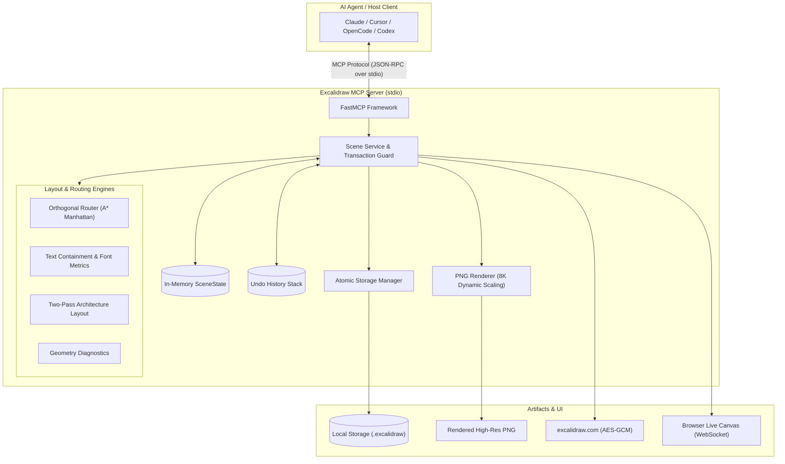

# Excalidraw MCP Server

> A high performance Model Context Protocol (MCP) server for programmatically generating, editing, and managing Excalidraw v2 diagrams with obstacle aware arrow routing, font accurate text containment, and automated layout resolution.

[](https://www.python.org/)
[](https://pypi.org/project/exca-mcp/)
[](https://github.com/jlowin/fastmcp)
[](https://modelcontextprotocol.io)
[](LICENSE)
[](https://hatch.pypa.io/)

---

## Overview

**Excalidraw MCP** empowers LLM agents (Claude, Cursor, OpenCode, Codex, and custom AI agents) to create, inspect, manipulate, and export rich [Excalidraw](https://excalidraw.com) diagrams directly from chat and automated workflows.

Built on [FastMCP](https://github.com/jlowin/fastmcp) using **Hatchling** as the build backend, it runs entirely local via standard I/O (`stdio`). It requires no browser, no headless Chromium, and no third party cloud hosting, rendering deterministic, production grade `.excalidraw` (schema v2) documents safely and atomically.

### Key Capabilities

- **Two-Tier Toolset Optimization (`EXCALIDRAW_TOOLSET`)**: Ships with a streamlined 27-tool `core` set enabled by default, reducing schema context overhead by **45.2%** (~6,560 tokens saved per LLM turn). Power users and interactive agents can enable all 48 tools by setting `EXCALIDRAW_TOOLSET=full`. Zero-token capability discovery is available via `excalidraw://capabilities`.
- **Obstacle Aware Orthogonal Arrow Routing**: Manhattan A* corridor pathfinding routes connectors cleanly around intermediate boxes, frames, and text with configurable clearance ($15\text{px}$). Arrows attach perpendicularly to cardinal faces (top, bottom, left, right) on rectangles, diamonds, and ellipses, preventing clipped arrowheads and wire collisions.
- **Multi Edge Parallel Lanes**: Automatically routes multiple connectors between the same components into distinct, parallel tracks ($20\text{px}$ lane spacing) so arrows and labels never superimpose.
- **Collision Free Label Positioning**: Ranks corridor segments to position connector labels along the longest clear segment away from arrowheads and obstacle boxes.
- **Font Aware Text Containment**: Accurate FreeType/Pillow font measurement (supporting Excalifont, Helvetica, Cascadia, and Comic Shanns) automatically wraps text and expands shapes outward from center. Rhombus and ellipse bounding geometry ensures labels never escape container borders.
- **Two Pass Architecture Layout Engine**: Content first sizing calculates text dimensions before positioning containers, automatically aligning multi tier architectures (Main Stack, Side Columns, Banners) with zero overlaps.
- **Dynamic 8K Canvas Scaling**: Content aware export bounds calculate margins from all visible elements, generating crystal clear high resolution PNGs up to 8192px without downscaling or text truncation.
- **Automated Geometry Diagnostics**: `check_diagram_geometry` automatically detects shape to shape overlaps, gap violations, frame containment escapes, and connector collisions.
- **Automated Layout Repair & Rollback Safety**: `auto_fix_layout` diagnoses, plans, and repairs layout defects (overlaps, text clipping, containment violations, connector collisions, and crowded spacing) across 5 strict topological phases with transactional rollback safety.
- **Mermaid & Architecture Shorthand**: Directly parse Mermaid flowcharts (`draw_mermaid`) or shorthand prompts (`draw_architecture`) into structured, fully editable Excalidraw scenes.
- **Unified Element & Viewport Management**: Simplified endpoints `set_element_locked` (lock/unlock), `manage_groups` (group/ungroup), and `set_viewport` (pan, zoom, and auto-focus framing) alongside backward-compatible legacy wrappers.
- **Syntax Highlighted Code Blocks**: `add_code_block` renders syntax highlighted code with line numbers, dark/light themes, and window controls.
- **Interactive Live Canvas & WebSocket Sync**: Built in HTTP and WebSocket server (`start_live_server`) synchronizes canvas changes with browser clients in real time.
- **End-to-End Encrypted Sharing**: Client side 128 bit AES-GCM encryption (`export_to_excalidraw_url`) publishes shareable links directly to excalidraw.com.
- **Atomic Operations & In-Memory Undo**: Non blocking transactions with process local undo history (`undo`) and memory budgets.
- **Automatic Agent Discovery**: Ships with a root `mcp.json` and `uvx` support for zero config onboarding across modern AI coding environments.

---

## Architecture & Workflow



### Agent Workflow
1. **Creation**: Agent invokes `draw_graph`, `draw_architecture`, `draw_mermaid`, or primitive shape tools (`add_rectangle`, `add_circle`, `connect`).
2. **Layout & Routing**: Layout engine positions components into balanced tiers and routes connectors through obstacle free corridors with parallel lane separation.
3. **Inspection & Revision**: Agent verifies element placement using `get_scene`, `get_element`, or `check_geometry`. If adjustments are needed, it calls `move`, `resize`, `update_element`, `reroute_connectors`, or `undo`.
4. **Persistence or Export**: The scene is saved locally with `save(name="arch-v1")`, exported as a high resolution image via `export_png` / `preview`, or published to excalidraw.com via `export_to_excalidraw_url`.

---

## Quick Start

You can run the Excalidraw MCP server using either `uvx` (recommended) or `pip`.

### Option 1: `uvx` (Recommended)

Run the server instantly without cloning the repository or manually managing dependencies using [`uvx`](https://docs.astral.sh/uv/):

```bash
uvx exca-mcp
```

> [!TIP]
> **Why `uvx` is recommended:** `uvx exca-mcp` executes the published PyPI package in an isolated, ephemeral environment. It fetches all required dependencies automatically without modifying or polluting your system or project Python environment.

### Option 2: `pip`

You can also install `exca-mcp` from PyPI into your active Python environment:

```bash
pip install exca-mcp
```

Once installed, run the server from the command line:

```bash
exca-mcp
```

> [NOTE]
> When using `pip`, the package is installed into your current Python environment. When configuring your MCP client (such as Claude Desktop or Cursor), ensure that your environment's executable directory (e.g., `~/.local/bin`, virtual environment `bin/`, or Windows `Scripts/`) is in your system `PATH`, or provide the absolute path to the `exca-mcp` binary.

---

## Client Configuration

Add `exca-mcp` to your favorite MCP client configuration file:

### Claude Desktop
Add this to `claude_desktop_config.json`:
- **macOS**: `~/Library/Application Support/Claude/claude_desktop_config.json`
- **Windows**: `%APPDATA%\Claude\claude_desktop_config.json`
- **Linux**: `~/.config/Claude/claude_desktop_config.json`

**Using `uvx` (Recommended):**
```json
{
  "mcpServers": {
    "excalidraw": {
      "command": "uvx",
      "args": [
        "exca-mcp"
      ]
    }
  }
}
```

**Using `pip` (Installed Executable):**
```json
{
  "mcpServers": {
    "excalidraw": {
      "command": "exca-mcp"
    }
  }
}
```
*(Note: If `exca-mcp` is not in your system `PATH`, provide the full absolute path, e.g. `/home/username/.venv/bin/exca-mcp` on macOS/Linux or `C:\\Users\\username\\.venv\\Scripts\\exca-mcp.exe` on Windows).*

### Cursor
Add to `.cursor/mcp.json` in your project root or user configuration:

**Using `uvx` (Recommended):**
```json
{
  "mcpServers": {
    "excalidraw": {
      "command": "uvx",
      "args": [
        "exca-mcp"
      ]
    }
  }
}
```

**Using `pip` (Installed Executable):**
```json
{
  "mcpServers": {
    "excalidraw": {
      "command": "exca-mcp"
    }
  }
}
```

### Zed
Add to your Zed `settings.json` (`~/.config/zed/settings.json` on macOS/Linux or `%APPDATA%\Zed\settings.json` on Windows):

**Using `uvx` (Recommended):**
```json
{
  "context_servers": {
    "excalidraw": {
      "command": {
        "path": "uvx",
        "args": [
          "exca-mcp"
        ]
      }
    }
  }
}
```

**Using `pip` (Installed Executable):**
```json
{
  "context_servers": {
    "excalidraw": {
      "command": {
        "path": "exca-mcp",
        "args": []
      }
    }
  }
}
```

### OpenCode
Add to `opencode.json` (or the MCP configuration section of your OpenCode settings):

**Using `uvx` (Recommended):**
```json
{
  "mcpServers": {
    "excalidraw": {
      "command": "uvx",
      "args": [
        "exca-mcp"
      ]
    }
  }
}
```

**Using `pip` (Installed Executable):**
```json
{
  "mcpServers": {
    "excalidraw": {
      "command": "exca-mcp"
    }
  }
}
```

### Codex / Generic Agent Configuration
For CLI agents and runners accepting standard `mcpServers` JSON:

**Using `uvx` (Recommended):**
```json
{
  "mcpServers": {
    "excalidraw": {
      "command": "uvx",
      "args": [
        "exca-mcp"
      ],
      "env": {
        "EXCALIDRAW_HISTORY_LIMIT": "25"
      }
    }
  }
}
```

**Using `pip` (Installed Executable):**
```json
{
  "mcpServers": {
    "excalidraw": {
      "command": "exca-mcp",
      "env": {
        "EXCALIDRAW_HISTORY_LIMIT": "25"
      }
    }
  }
}
```

---

## Automatic Agent Discovery

This repository comes pre-packaged with a root [`mcp.json`](mcp.json) descriptor:

```json
{
  "mcpServers": {
    "excalidraw": {
      "command": "uvx",
      "args": [
        "exca-mcp"
      ]
    }
  }
}
```

When an MCP compliant agent tool (e.g. `fastmcp list mcp.json`, Cursor, or Zed) scans your workspace, it will automatically detect the server and register the default 27 `core` tools (or all 48 tools when `EXCALIDRAW_TOOLSET=full`) with zero manual configuration.

---

## MCP Tools Reference

> [!IMPORTANT]
> **BREAKING CHANGE (v0.2.0)**: The default server configuration now exposes the streamlined **`CORE` toolset (27 tools)** instead of the full 48-tool set, reducing prompt schema overhead by 45.2% (~6,560 tokens per turn). If your agent workflows or MCP clients require advanced tools (`draw_graph`, `batch_mutate`, camera viewports, element locking, grouping, or the background live canvas server), restore the previous 48-tool behavior by setting the environment variable:
> ```bash
> export EXCALIDRAW_TOOLSET=full
> ```

The server supports two configurable toolsets controlled by `EXCALIDRAW_TOOLSET`:
- **`CORE` Set (27 tools, Default)**: The essential generation-edit-inspect-validate-export workflow for autonomous coding agents. Saves **45.2% in schema tokens** (~6,560 tokens per turn).
- **`FULL` Set (48 tools)**: Includes all `CORE` tools plus advanced layered graph generators (`draw_graph`), atomic batch transactions (`batch_mutate`), element locking, grouping, camera viewports, and the background live canvas server.

All tools are strictly typed with JSON Schema bounds and explicit safety hints (`readOnly`, `destructive`, `idempotent`).

### 1. High Level Generation & Design Guidance

| Tool | Toolset | Inputs | Outputs | Description |
|---|---|---|---|---|
| `draw_mermaid` | **CORE** | `mermaid_code: str`<br>`direction: str | None = None`<br>`layout: str = "layered"`<br>`elbowed: bool = False`<br>`roundness: str | None = None` | `GraphResult`<br>`{ status, nodes, edges, node_map, edge_map, cluster_map, revision }` | Parses Mermaid flowchart/graph syntax (`graph TD`, `flowchart LR`, subgraphs, node shapes, edge styles) and renders directly to Excalidraw with automatic text containment. |
| `draw_architecture` | **CORE** | `prompt: str` (e.g., `"box: Frontend, db: Postgres"`)<br>`wrap_threshold: int = 4`<br>Optional styles (`strokeColor`, `backgroundColor`, etc.) | `ArchitectureResult`<br>`{ revision, element_count, components }` | Rapid diagram generator parsing comma/newline-separated shorthand syntax (`box`, `circle`, `diamond`) with grid-wrapping and automatic obstacle-avoiding connectors. |
| `draw_graph` | FULL | `nodes: list[GraphNode]`<br>`edges: list[GraphEdge]`<br>`clusters: list[GraphCluster] = None`<br>`layout: str = "layered"` (`layered`, `horizontal`, `vertical`)<br>`direction: str = "horizontal"` (`horizontal`, `vertical`)<br>`elbowed: bool = False`<br>`roundness: str | None = None` | `GraphResult`<br>`{ revision, element_count, node_map, edge_map, cluster_map }` | Replaces the scene with a structured diagram using automatic topological ranking, obstacle aware edge routing, clustered frame grouping, and font aware label wrapping. Returns stable logical to element ID mappings. |
| `read_diagram_guide` | FULL | `topic: str | None = None` (`layout`, `colors`, `typography`, `grouping`, `arrows`, `spacing` ) | `DiagramGuideResult`<br>`{ topic, guide, available_topics }` | Practical diagram design guidelines covering 60-30-10 color rules, semantic palettes, standard node dimensions, margins, orthogonal arrow routing, and readability. |

### 2. Primitive Shapes, Text, Code Blocks & Frames

| Tool | Toolset | Inputs | Outputs | Description |
|---|---|---|---|---|
| `add_rectangle` | **CORE** | `x: float`, `y: float`, `w: float`, `h: float`<br>`label: str = ""` + styles + `roundness: str = None`, `frame_id: str = None` | `CreateResult`<br>`{ rectangle_id, label_id }` | Adds a rectangle to the active scene with an optional centered bound label, adaptive/round corner roundness, frame membership, and automatic outward expansion. |
| `add_circle` | **CORE** | `x: float`, `y: float`, `size: float`<br>`label: str = ""` + styles + `frame_id: str = None` | `CreateResult`<br>`{ circle_id, label_id }` | Adds a circle (ellipse) with an optional centered bound label, ellipse inscribed boundary containment, and frame membership. |
| `add_diamond` | **CORE** | `x: float`, `y: float`, `w: float`, `h: float`<br>`label: str = ""` + styles + `roundness: str = None`, `frame_id: str = None` | `CreateResult`<br>`{ diamond_id, label_id }` | Adds a decision diamond with rhombus inscribed boundary containment, adaptive roundness, and frame membership. |
| `add_arrow` | **CORE** | `x: float`, `y: float`, `x2: float`, `y2: float`<br>`label: str = ""` + styles + `elbowed: bool = False` | `CreateResult`<br>`{ arrow_id, label_id }` | Adds a directional arrow (straight or elbowed) with an optional corridor positioned label. |
| `add_text` | **CORE** | `x: float`, `y: float`, `content: str`<br>`font_size: int = 20` + styles + `frame_id: str = None` | `CreateResult`<br>`{ text_id }` | Creates a standalone text element with accurate FreeType font metrics and optional frame membership. |
| `connect` | **CORE** | `source_id: str`, `target_id: str`<br>`label: str = ""` + styles + `elbowed: bool = False` | `ConnectResult`<br>`{ arrow_id, label_id }` | Binds two existing shapes with obstacle aware orthogonal routing, cardinal face boundary docking, and multi edge lane separation. |
| `add_frame` | **CORE** | `name: str = ""`, `x: float`, `y: float`, `w: float`, `h: float`<br>`element_ids: list[str] = None` | `CreateResult`<br>`{ frame_id }` | Creates an Excalidraw frame container and optionally parents specified elements inside it. |
| `add_code_block` | FULL | `code: str`<br>`language: str = "python"`<br>`x: float = 0`, `y: float = 0`<br>`title: str = None`<br>`theme: str = "dark"`<br>`font_size: int = 14`<br>`line_numbers: bool = True`<br>`w: float = None`, `h: float = None`<br>`frame_id: str = None` | `CodeBlockResult`<br>`{ status, container_id, text_id, width, height, revision }` | Adds a syntax highlighted code block with window controls, configurable themes, line numbers, and monospace typography. |

### 3. Scene Editing & Manipulation

| Tool | Toolset | Inputs | Outputs | Description |
|---|---|---|---|---|
| `move` | **CORE** | `element_id: str`, `x: float`, `y: float` | `MoveResult`<br>`{ status, element_id, x, y }` | Repositions an element. Moving a frame moves all contained elements; moving grouped elements moves group members together; rejects locked elements. |
| `resize` | **CORE** | `element_id: str`, `width: float`, `height: float` | `ResizeResult`<br>`{ status, element_id, width, height }` | Resizes a shape or frame, recalculates label centering, and reroutes connected arrows; rejects locked elements. |
| `update_element` | **CORE** | `element_id: str`<br>`label: str | None = None` + styles + `roundness`, `elbowed`, `frame_id` | `UpdateResult`<br>`{ status, element_id, label_id }` | Modifies an element's label, styling, roundness mode, elbowed connector routing, or frame assignment with automatic center anchored container expansion. |
| `delete` | **CORE** | `element_id: str` | `DeleteResult`<br>`{ status, deleted_ids }` | Deletes an element and its bound label; unparents frame children if a frame is deleted; cleans up references in connected arrows; rejects locked elements. |
| `auto_fix_layout` | **CORE** | `name: str \| None = None`<br>`dry_run: bool = False`<br>`repair_scope: str = "all"`<br>`aggressiveness: str = "balanced"`<br>`min_gap: float = 30.0` | `AutoFixLayoutResult`<br>`{ status, dry_run, initial_issues, final_issues, fixed_issues_count, unresolved_issues, planned_changes, applied_changes, changed_element_ids, skipped_repairs, warnings, rolled_back, revision }` | Diagnoses, plans, and repairs layout defects (overlaps, text clipping, containment violations, connector collisions, and crowded spacing) with transactional rollback safety across 5 strict topological phases. |
| `clear` | **CORE** | None | `DeleteResult`<br>`{ status }` | Wipes the entire scene, active elements, and embedded state. |
| `undo` | **CORE** | None | `UndoResult`<br>`{ status, revision }` | Rolls back the scene to the state immediately preceding the latest mutation. |
| `set_element_locked` | FULL | `element_ids: list[str]`, `locked: bool = True` | `LockResult \| UnlockResult`<br>`{ status, element_ids, revision }` | Unified tool to lock or unlock elements and their bound labels to prevent or permit mutations. |
| `lock_elements` | FULL | `element_ids: list[str]` | `LockResult`<br>`{ status, element_ids, revision }` | Legacy wrapper calling `set_element_locked(element_ids, locked=True)`. |
| `unlock_elements` | FULL | `element_ids: list[str]` | `UnlockResult`<br>`{ status, element_ids, revision }` | Legacy wrapper calling `set_element_locked(element_ids, locked=False)`. |
| `manage_groups` | FULL | `element_ids: list[str] = None`<br>`group_id: str = None`<br>`action: str = "group"` (`group`, `ungroup`) | `GroupResult \| UngroupResult` | Unified tool to group elements together or disband existing groups. |
| `group_elements` | FULL | `element_ids: list[str]` | `GroupResult`<br>`{ status, group_id, element_ids, revision }` | Legacy wrapper calling `manage_groups(element_ids=element_ids, action="group")`. |
| `ungroup_elements` | FULL | `element_ids: list[str] = None`<br>`group_id: str = None` | `UngroupResult`<br>`{ status, affected_elements, removed_group_ids, revision }` | Legacy wrapper calling `manage_groups(element_ids=element_ids, group_id=group_id, action="ungroup")`. |
| `duplicate_elements` | FULL | `element_ids: list[str]`<br>`offset_x: float = 20.0`<br>`offset_y: float = 20.0` | `DuplicateResult`<br>`{ status, original_ids, duplicated_ids, id_mapping, revision }` | Duplicates multiple elements with spatial offsets, relationship remapping, arrow endpoint retargeting, bound label cloning, and group isolation. |
| `batch_mutate` | FULL | `operations: list[dict]` | `BatchResult`<br>`{ status, operations_executed, ref_map, results, revision }` | Atomically executes multiple creation, connection, movement, resize, lock, group, duplicate, auto_fix_layout, or update actions in a single revision step with dynamic `client_id` resolution. |

### 4. Inspection, Viewport, Query, Export & Sharing

| Tool | Toolset | Inputs | Outputs | Description |
|---|---|---|---|---|
| `describe_scene` | **CORE** | `detailed: bool = True` | `SceneDescriptionResult`<br>`{ summary, element_count, layout_type, elements, connections, bounds, revision }` | Produces an AI-readable summary of elements, positions, labels, flow connections, topological layout, and bounds. |
| `get_scene_summary` | **CORE** | None | `SceneSummaryResult`<br>`{ element_count, type_counts, frames, groups, connectors, code_blocks, standalone_elements, bounds, description, revision }` | Provides a structured semantic overview and topological understanding of the entire diagram for AI agent reasoning. |
| `get_scene` | **CORE** | `offset: int = 0`, `limit: int = 50` | `ScenePage`<br>`{ elements, total, offset, limit, has_more, revision }` | Paginated inspection of all elements currently on the canvas. |
| `get_element` | **CORE** | `element_id: str` | `ElementResult`<br>`{ element, revision }` | Fetches details and properties of a single element by its ID. |
| `preview` | **CORE** | `scale: float = 1.0`<br>`padding: int = 40`<br>`background: bool = True` | `ImageContent`<br>(`image/png`) | Renders an inline PNG image preview of the active Excalidraw canvas directly into the chat conversation with dynamic canvas scaling up to 8K. |
| `export_png` | **CORE** | `name: str`<br>`directory: str | None = None`<br>`scale: float = 1.0`<br>`padding: int = 40`<br>`background: bool = True`<br>`overwrite: bool = False` | `PngExportResult`<br>`{ status, name, path, bytes, width, height }` | Atomically exports the active scene directly to a PNG image file in a project folder or configured directory. |
| `save` | **CORE** | `name: str`, `overwrite: bool = False` | `SaveResult`<br>`{ status, name, path }` | Atomically writes the scene to server disk in `.excalidraw` JSON format. |
| `load` | **CORE** | `name: str` | `LoadResult`<br>`{ status, name, elements }` | Atomically loads a saved `.excalidraw` file and sets it as the active scene. |
| `export_scene` | **CORE** | None | `EmbeddedResource`<br>(`application/vnd.excalidraw+json`) | Emits the entire `.excalidraw` schema v2 document directly into the MCP message. |
| `set_viewport` | FULL | `scroll_x: float = None`<br>`scroll_y: float = None`<br>`zoom: float = None`<br>`background_color: str = None`<br>`focus_element_ids: list[str] = None`<br>`padding: int = 50` | `ViewportResult \| FocusResult` | Updates canvas camera scroll offsets, zoom level, background canvas color, or automatically frames on specified elements. |
| `get_viewport` | FULL | None | `ViewportResult`<br>`{ scroll_x, scroll_y, zoom, view_background_color, revision }` | Inspects current canvas camera scroll coordinates, zoom factor, and background color. |
| `focus_elements` | FULL | `element_ids: list[str] = None`<br>`padding: int = 50` | `FocusResult`<br>`{ status, scroll_x, scroll_y, zoom, bounding_box, focused_element_ids, revision }` | Legacy wrapper delegating to `set_viewport(focus_element_ids=element_ids, padding=padding)`. |
| `find_elements` | **CORE** | `query: str | None`<br>`type: str | None`<br>`frame_id: str | None`<br>`element_id: str | None`<br>`connected_to: str | None`<br>`include_bound_labels: bool = False`<br>`limit: int = 50` | `FindResult`<br>`{ matches, total, revision }` | Filters active elements by text search, element type, parent frame, ID, or graph connectivity. |
| `list_saved_scenes`| FULL | None | `SavedScenesResult`<br>`{ scenes: list[str] }` | Returns a list of all scene files stored in the persistent directory. |
| `list_fonts` | FULL | `category: str | None` (`sans-serif`, `monospace`, `serif`, `handwriting`) | `FontListResult`<br>`{ fonts, total, defaults }` | Discovers and lists available system fonts and semantic font categories. |
| `get_resource` | **CORE** | `uri: str | None = None`<br>`resource_type: str | None = None`<br>`identifier: str | None = None` | `ResourceResult`<br>`{ resource_type, identifier, document, theme, library, element, ... }` | Retrieves scene, library (`architecture`, `flowchart`, `cloud`), theme (`default`, `dark`, `light`, `monokai`, `nord`, `solarized`), or element resources through a unified interface. |
| `import_scene` | FULL | `data: str`<br>`mode: str = "replace"` (`replace`, `merge`)<br>`offset_x: float = 0.0`<br>`offset_y: float = 0.0` | `ImportResult`<br>`{ status, mode, elements_imported, total_elements, id_mapping, revision }` | Imports Excalidraw scenes from raw JSON, `.excalidraw` files, Obsidian `.excalidraw.md` files, or embedded PNGs with reference preservation and collision remapping. |
| `export_to_excalidraw_url` | FULL | `name: str | None = None` | `ShareUrlResult`<br>`{ status, url, id, revision }` | Publishes active or saved scene to excalidraw.com using 128-bit AES-GCM client-side encryption and returns a shareable URL. |

### 5. Live Canvas Server & Browser Synchronization

| Tool | Toolset | Inputs | Outputs | Description |
|---|---|---|---|---|
| `start_live_server` | FULL | `host: str = "127.0.0.1"`<br>`port: int = 8080` | `LiveServerResult`<br>`{ status, url, host, port }` | Launches the interactive browser connected live canvas server with real-time WebSocket synchronization. |
| `stop_live_server` | FULL | None | `LiveServerResult`<br>`{ status }` | Gracefully shuts down the background live canvas server and closes active client connections. |
| `get_live_server_status` | FULL | None | `LiveServerResult`<br>`{ is_running, url, host, port, active_clients }` | Reports operational status, connection URL, and connected client count of the live canvas server. |

---

## Automated Layout Repair Engine (`auto_fix_layout`)

The `auto_fix_layout` tool provides deterministic layout repair with transactional rollback safety. It detects, plans, and repairs layout defects across five strict topological phases:

1. **Text Containment & Box Resizing**: Expands containers outward from center to enclose multiline text without clipping and without drifting off-center. User text content is never altered.
2. **Minimal-Displacement De-Collision**: Resolves node-to-node overlaps along the axis of least resistance while keeping grouped peers strictly aligned. Discriminates intentional overlaps (elements in explicit groups, `allow_overlap` custom data, or nested child containers).
3. **Frame Boundary Expansion**: Expands frames to encompass all member children plus configurable padding.
4. **Obstacle-Aware Connector Rerouting**: Reroutes crossing arrows around intermediate obstacles with orthogonal clearance corridors.
5. **Spacing Adjustments**: Automatically widens sub-optimal gaps between crowded components.

### Parameters
- `name` (*str*, optional): Target a saved scene file on disk. If omitted, operates on the active in-memory scene.
- `dry_run` (*bool*, default `False`): Preview planned changes, predicted final issues, and applied transformations without mutating scene state. Note: Executes all five phases including A* rerouting on an isolated snapshot, incurring the same compute cost as a real run.
- `repair_scope` (*str*, default `"all"`): Constrain repairs to specific defect categories:
  - `"all"`: Executes all 5 repair phases.
  - `"overlaps"`: Node-to-node collisions.
  - `"connectors"`: Connector collisions with obstacle shapes.
  - `"containment"`: Frame boundary containment expansion only.
  - `"text"`: Text clipping container expansion only.
  - `"spacing"`: Component gap widening only.
- `aggressiveness` (*str*, default `"balanced"`): Margin and clearance multiplier:
  - `"gentle"`: `0.8x` multiplier for a smaller expansion (does not compact existing gaps).
  - `"balanced"`: `1.0x` standard layout spacing.
  - `"aggressive"`: `1.35x` generous clearance corridors.
- `min_gap` (*float*, default `30.0`): Minimum clearance distance in pixels between shapes (between 0 and 1000). Spacing defect detection triggers at an effective threshold of `min_gap * 0.65` (~19.5px for default 30.0).

### Transactional Rollback Guarantee
Before mutating any elements, an immutable snapshot of the scene is created. After repair execution, diagnostics are automatically re-run. If severe defects increase (regression detected), all modifications are discarded, restoring the pre-repair snapshot with `rolled_back = True`. If the diagram is already clean or repairs produce no changes, idempotency guarantees zero mutations (`status = "no_changes_needed"`).

### Opting out of overlap detection

To exempt specific shapes from overlap resolution (for example, intentionally overlaid badges, watermarks, or complex composite elements), set `"allow_overlap": true` in the element's `customData`:

```json
{"customData": {"allow_overlap": true}}
```

Elements with `customData.allow_overlap = true` will not be treated as collision defects or displaced during layout repair. If `allow_overlap` is present but is not a boolean, a warning is emitted and it is treated as `false`.

### Usage Example

```python
# Repair active canvas with dry-run preview
preview_result = await client.call_tool("auto_fix_layout", {
    "dry_run": True,
    "repair_scope": "all",
    "aggressiveness": "balanced",
    "min_gap": 30.0,
})

# Apply atomic repairs in a batch transaction
batch_result = await client.call_tool("batch_mutate", {
    "operations": [
        {"action": "add_rectangle", "client_id": "r1", "x": 100, "y": 100, "w": 100, "h": 60, "label": "Service A"},
        {"action": "add_rectangle", "client_id": "r2", "x": 140, "y": 100, "w": 100, "h": 60, "label": "Service B"},
        {"action": "auto_fix_layout", "repair_scope": "all", "min_gap": 35.0},
    ]
})
```

---

## MCP Resources

In addition to tools, the server exposes resources via standard MCP resource URIs:
- **`excalidraw://capabilities`** (`application/json`): Inspect active toolset (`core` or `full`), available toolset modes, tool counts, and supported capabilities without consuming prompt schema tokens.
- **`excalidraw://scenes/{name}.excalidraw`** (`application/vnd.excalidraw+json`): Read saved `.excalidraw` JSON documents directly into agent context without altering the active working canvas.

---

## Environment Variables & Configuration

The server operates with secure defaults and zero required environment variables. Fine tune performance, tool exposure, and resource limits via the environment:

| Variable | Default | Allowed Values | Description |
|---|---|---|---|
| `EXCALIDRAW_TOOLSET` | `core` | `core`, `full` | Configures exposed tool footprint. `core` registers 27 essential tools (saving 45.2% schema tokens); `full` registers all 48 tools including legacy wrappers and live server tools. |
| `EXCALIDRAW_SCENE_DIR` | Platform User Data | Absolute path | Directory where scenes are persisted. Defaults to `$XDG_DATA_HOME/excalidraw-mcp/scenes` on Linux, `~/Library/Application Support/excalidraw-mcp/scenes` on macOS, and `%APPDATA%\excalidraw-mcp\scenes` on Windows. |
| `EXCALIDRAW_EXPORT_DIR` | `$EXCALIDRAW_SCENE_DIR/exports` | Absolute path | Configurable directory where PNG diagram exports are saved by default. |
| `EXCALIDRAW_DEFAULT_FONT` | Platform Sans Font | Font family name | Preferred system font family for regular diagram text and labels. |
| `EXCALIDRAW_MONO_FONT` | Platform Monospace Font | Font family name | Preferred monospace font family for code blocks and code annotations. |
| `EXCALIDRAW_FONT_DIR` | None | Directory path | Additional custom directory scanned for TrueType (`.ttf`) and OpenType (`.otf`) fonts. |
| `EXCALIDRAW_HISTORY_LIMIT` | `20` | `1`–`100` | Maximum number of in-memory undo snapshots retained per session. |
| `EXCALIDRAW_MAX_HISTORY_BYTES` | `104857600` (100 MiB) | 1 KiB–500 MiB | Shared memory ceiling allocated for serialized undo states. |
| `EXCALIDRAW_MAX_SCENE_BYTES` | `26214400` (25 MiB) | 1 KiB–100 MiB | Maximum file size permitted when saving or loading scene files. |
| `EXCALIDRAW_MAX_EXPORT_BYTES` | `26214400` (25 MiB) | 1 KiB–100 MiB | Maximum payload size permitted for `export_scene` and resource reads. |
| `EXCALIDRAW_MAX_ELEMENTS` | `10000` | `1`–`100,000` | Hard cap on the total number of elements allowed per scene. |

---

## Local Development & Debugging

### Prerequisites
- Python `>= 3.12`
- [`uv`](https://docs.astral.sh/uv/) (recommended) or `pip`

### 1. Clone & Set Up Environment

```bash
git clone https://github.com/Dharshan2208/excalidraw-mcp.git
cd excalidraw-mcp

# Synchronize dependencies with uv
uv sync

# Or with pip & virtualenv
python3 -m venv .venv
source .venv/bin/activate
pip install -e .
```

> [NOTE]
> Installing in editable mode (`pip install -e .`) registers the local `exca-mcp` executable linked directly to the internal `excalidraw_mcp` Python module in your development environment.

### 2. Run the Test Suite

The test suite contains **450 comprehensive unit and contract tests** verifying Excalidraw serialization, obstacle aware arrow routing, text containment and font metrics, two pass architecture layout, 8K dynamic scaling, storage safety, PNG export, code blocks, live server synchronization, sharing, and MCP schemas:

```bash
uv run --locked python -B -m unittest discover -s tests -v
```

### 3. Interactive Debugging with FastMCP Inspector

Inspect schemas, invoke tools interactively, and test stdio communications using the built-in FastMCP web inspector:

```bash
uv run fastmcp inspect mcp.json
```

Or list discovered tools:

```bash
uv run fastmcp list mcp.json
```

### 4. Running the Development Server Directly

You can execute the development server locally via the installed CLI script or using the Python module directly:

```bash
# Using the installed script entry point:
exca-mcp

# Or directly using the Python module:
python -m excalidraw_mcp
```

### 5. Packaging Verification

Test source distribution and wheel generation with Hatchling:

```bash
uv build
```

---

## Contributing

Contributions are warmly welcomed! Please follow these guidelines:

1. **Fork the Repository**: Create a descriptive feature branch (`git checkout -b feat/custom-styling`).
2. **Adhere to Code Standards**: Ensure clean type annotations, preserve existing docstrings, and maintain standard exception hierarchies.
3. **Verify Tests**: Run `uv run --locked python -B -m unittest discover -s tests -v` and ensure all 450 tests pass.
4. **Compile Check**: Confirm no byte compilation warnings via:
   ```bash
   uv run python -B -m compileall -q -f main.py excalidraw_mcp tests
   ```
5. **Submit a Pull Request**: Provide a concise summary of the rationale and changes.

---

## Standards & License

- **Protocol Specification**: Complies with the official [Model Context Protocol Specification](https://modelcontextprotocol.io).
- **Document Format**: Serializes to standard [Excalidraw schema v2](https://github.com/excalidraw/excalidraw).
- **License**: Released under the [MIT License](LICENSE).
