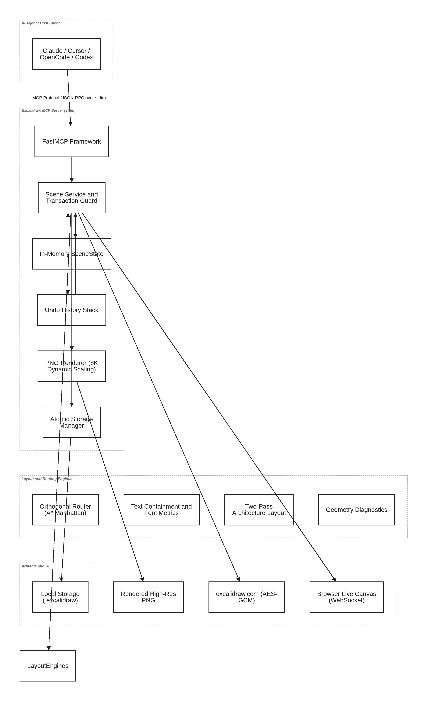
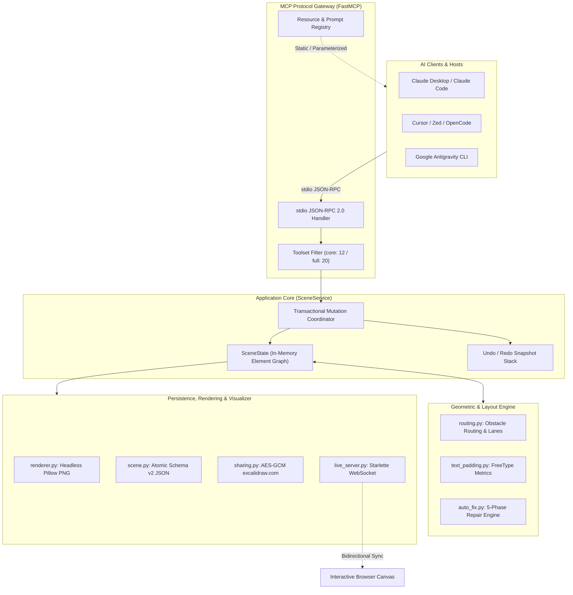

# Architecture & Implementation

This document provides a technical deep dive into the internal design, subsystems, and execution flow of the Excalidraw MCP Server (`exca-mcp`).

*Figure: Multi-tier architectural topology of the Excalidraw MCP server.*

---

## Architectural Overview

The server operates as an in-memory Model Context Protocol (MCP) server running on FastMCP, mediating between AI coding assistants, human editors, and diagram files.

---

## Subsystems

### 1. Protocol Layer (FastMCP & stdio)
- Implements the MCP JSON-RPC 2.0 specification over standard input/output (`stdio`).
- Registers tools with explicit input and output schemas, JSON Schema constraints, and safety annotations (`readOnlyHint`, `destructiveHint`, `idempotentHint`).
- Controls tool schema exposure based on `EXCALIDRAW_TOOLSET`:
  - `core` (default): 12 curated tools (~5,048 compact tokens).
  - `full`: 21 tools (~7,937 compact tokens).
- Strips redundant `outputSchema` definitions and serializes tool outputs to minified compact JSON, eliminating wire duplication.
- Serves static and parameterized MCP resources (`excalidraw://capabilities`, `excalidraw://fonts`, `excalidraw://guide/{topic}`, `exca-mcp://skills/index`) and task prompts.

### 2. State & Transaction Engine (`SceneService`)
- **Single Source of Truth (`SceneState`)**: Maintains the active scene elements, app state, and embedded files in memory.
- **Atomic Mutations**: Mutations increment a monotonic revision counter. Operations that encounter errors abort cleanly without leaving partial state.
- **Undo History**: Process-local undo history stack, bounded by `EXCALIDRAW_HISTORY_LIMIT` (snapshots) and `EXCALIDRAW_MAX_HISTORY_BYTES` (memory budget).

### 3. Geometric Computation Subsystems

#### Obstacle-Aware Routing (`routing.py`)
- Calculates orthogonal connector paths between shapes using Manhattan routing.
- Identifies bounding box obstacles and routes connectors through free clearance corridors (15 px margin).
- Dynamically attaches to cardinal-face dock ports (top, bottom, left, right) on shapes.
- Displaces parallel multi-edge connections into distinct lanes (24 px displacement) to avoid line superposition.

#### Text Metrics & Font Padding (`text_padding.py`, `fonts.py`)
- Analyzes font metrics and string lengths using FreeType and Pillow.
- Ensures text labels fit within inscribed rectangular, rhombus, and ellipse boundaries with proper internal margins.

#### Automated Layout Repair Engine (`auto_fix.py`)
- Implements a deterministic 5-phase repair pipeline:
  1. Container text clipping expansion outward from center.
  2. Overlap minimal-displacement de-collision along the axis of least resistance.
  3. Frame boundary containment padding expansion.
  4. Obstacle-aware connector rerouting.
  5. Component spacing adjustments for crowded nodes.
- Enforces an automated rollback guarantee: if a repair phase introduces new collisions or worsens defect counts, the transaction rolls back cleanly. See [docs/auto-fix-layout.md](auto-fix-layout.md).

### 4. Rendering & Export Subsystems
- **Headless Rasterization (`renderer.py`)**: Pillow-powered rasterization generating PNG exports up to 8192 px and inline previews capped to model envelopes (`max_dimension=1568`).
- **Scene Serialization (`scene.py`)**: Confined, atomic scene persistence in native Excalidraw Schema v2 format (`.excalidraw`).
- **Encrypted Web Sharing (`sharing.py`)**: Client-side 128-bit AES-GCM encrypted URL generation for direct sharing to `excalidraw.com`.

### 5. Live Canvas Synchronization Engine (`live_server.py`)
- Starlette / Uvicorn ASGI engine running on a background thread.
- WebSocket bi-directional sync between the in-memory `SceneService` and an interactive browser canvas.
- Protected by token authentication (`EXCALIDRAW_LIVE_TOKEN`), CSWSH origin validation, and remote interface binding restrictions (`EXCALIDRAW_ALLOW_REMOTE`). See [docs/security.md](security.md).
