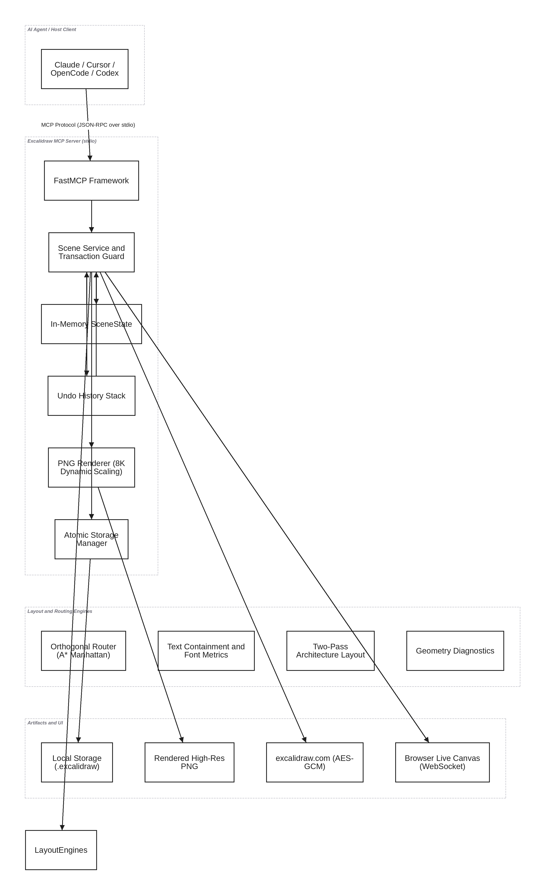

# Architecture & Implementation

This document provides a technical deep dive into the internal design, subsystems, and execution flow of the Excalidraw MCP Server (`exca-mcp`).

## Architectural Overview

The server operates as an in-memory Model Context Protocol (MCP) server running on FastMCP, mediating between AI coding assistants, human editors, and diagram files.

### 1. Protocol Layer (FastMCP & stdio)
- Implements the MCP JSON-RPC 2.0 specification over standard input/output (`stdio`).
- Registers tools with explicit input and output schemas, JSON Schema constraints, and annotations (`readOnly`, `destructive`, `idempotent`).
- Controls tool schema exposure based on `EXCALIDRAW_TOOLSET`:
  - `core` (default): 27 essential tools.
  - `full`: 48 comprehensive tools.
- Serves MCP resources (`excalidraw://capabilities`, `excalidraw://skills`, `excalidraw://scenes/{name}.excalidraw`) and task prompts.

### 2. State & Transaction Engine (`SceneService`)
- **Single Source of Truth (`SceneState`)**: Maintains the active scene elements, app state, and embedded files in memory.
- **Atomic Mutations**: Mutations increment a monotonic revision counter. Operations that encounter errors are aborted without leaving partial state.
- **Undo History**: Process-local undo history stack, bounded by `EXCALIDRAW_HISTORY_LIMIT` and `EXCALIDRAW_MAX_HISTORY_BYTES`.

### 3. Geometric Computation Subsystems

#### Obstacle-Aware Routing (`routing.py`)
- Calculates orthogonal connector paths between shapes.
- Identifies bounding box obstacles and routes connectors through free clearance corridors.
- Displaces parallel multi-edge connections into distinct lanes to avoid line superposition.

#### Text Metrics & Font Padding (`text_padding.py`, `fonts.py`)
- Analyzes font metrics and string lengths to dynamically calculate shape bounds.
- Ensures text labels fit within inscribed rectangular boundaries with proper internal margins.

#### Automated Layout Repair Engine (`auto_fix.py`)
- Implements a 5-phase repair pipeline:
  1. Container text clipping expansion
  2. Overlap minimal-displacement de-collision
  3. Frame boundary containment padding
  4. Obstacle-aware connector rerouting
  5. Component spacing adjustments
- Enforces an automated rollback guarantee: if a repair phase introduces new collisions or worsens defect counts, the transaction rolls back cleanly.

### 4. Rendering & Export Subsystems
- Headless rasterization via Pillow for `preview` and `export_png`.
- Scene serialization to Excalidraw Schema v2 JSON (`.excalidraw`).
- AES-GCM encrypted URL generation for direct sharing to `excalidraw.com`.

### 5. Live Canvas Synchronization Engine (`live_server.py`)
- Starlette / Uvicorn ASGI engine running on a background thread.
- WebSocket bi-directional sync between the in-memory `SceneService` and an interactive browser canvas.
- Protected by token authentication, CSWSH origin validation, and remote interface binding restrictions.
