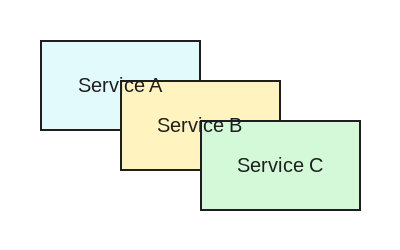
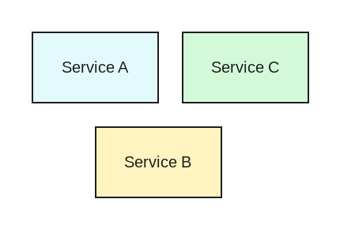
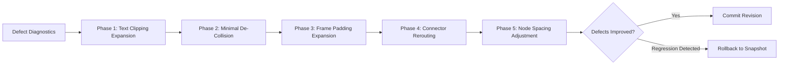

# Automated Layout Repair Engine (`auto_fix_layout`)

The `auto_fix_layout` tool provides deterministic layout repair with transactional rollback safety. It detects, plans, and repairs layout defects across five strict topological phases.

---

## Visual Comparison

| Before Auto-Fix (Overlapping & Crowded Nodes) | After Auto-Fix (Repaired Clearances & Aligned Routing) |
|---|---|
|  |  |

---

## 5-Phase Repair Pipeline



1. **Text Containment & Box Resizing**: Expands containers outward from center to enclose multiline text without clipping and without drifting off-center. User text content is never altered.
2. **Minimal-Displacement De-Collision**: Resolves node-to-node overlaps along the axis of least resistance while keeping grouped peers strictly aligned. Discriminates intentional overlaps (elements in explicit groups, `allow_overlap` custom data, or nested child containers).
3. **Frame Boundary Expansion**: Expands frames to encompass all member children plus configurable padding.
4. **Obstacle-Aware Connector Rerouting**: Reroutes crossing arrows around intermediate obstacles with orthogonal clearance corridors.
5. **Spacing Adjustments**: Automatically widens sub-optimal gaps between crowded components.

---

## Parameters

- `name` (*str*, optional): Target a saved scene file on disk. If omitted, operates on the active in-memory scene.
- `dry_run` (*bool*, default `False`): Preview planned changes, predicted final issues, and applied transformations without mutating scene state. Note: Executes all five phases including A* rerouting on an isolated snapshot, incurring the same compute cost as a real run.
- `repair_scope` (*str*, default `"all"`): Constrain repairs to specific defect categories:
  - `"all"`: Executes all 5 repair phases.
  - `"overlaps"`: Node-to-node collisions.
  - `"connectors"`: Connector collisions with obstacle shapes.
  - `"containment"`: Frame boundary containment expansion only.
  - `"text"`: Text clipping container expansion only.
  - `"spacing"`: Component gap widening only.
- `aggressiveness` (*str*, default `"balanced"`): Margin and clearance multiplier:
  - `"gentle"`: `0.8x` multiplier for a smaller expansion (does not compact existing gaps).
  - `"balanced"`: `1.0x` standard layout spacing.
  - `"aggressive"`: `1.35x` generous clearance corridors.
- `min_gap` (*float*, default `30.0`): Minimum clearance distance in pixels between shapes (between 0 and 1000). Spacing defect detection triggers at an effective threshold of `min_gap * 0.65` (~19.5px for default 30.0).
- `verbose` (*bool*, default `False`): When `False`, returns a compact summary with truncated defect lists to conserve agent turn tokens. When `True`, returns full lists.

---

## Transactional Rollback Guarantee

Before mutating any elements, an immutable snapshot of the scene is created. After repair execution, diagnostics are automatically re-run. If severe defects increase (regression detected), all modifications are discarded, restoring the pre-repair snapshot with `rolled_back = True`. If the diagram is already clean or repairs produce no changes, idempotency guarantees zero mutations (`status = "no_changes_needed"`).

---

## Opting Out of Overlap Detection

To exempt specific shapes from overlap resolution (for example, intentionally overlaid badges, watermarks, or complex composite elements), set `"allow_overlap": true` in the element's `customData`:

```json
{"customData": {"allow_overlap": true}}
```

Elements with `customData.allow_overlap = true` will not be treated as collision defects or displaced during layout repair. If `allow_overlap` is present but is not a boolean, a warning is emitted and it is treated as `false`.

---

## Practical Usage Example

```python
# 1. Preview layout defects without mutating canvas (dry-run simulation)
preview_result = auto_fix_layout(
    dry_run=True,
    repair_scope="all",
    aggressiveness="balanced",
    min_gap=30.0
)

# 2. Apply atomic repairs in a batch transaction
batch_result = batch_mutate(operations=[
    {"action": "add_rectangle", "client_id": "r1", "x": 100, "y": 100, "w": 100, "h": 60, "label": "Service A"},
    {"action": "add_rectangle", "client_id": "r2", "x": 140, "y": 100, "w": 100, "h": 60, "label": "Service B"},
    {"action": "auto_fix_layout", "repair_scope": "all", "min_gap": 35.0}
])
```
