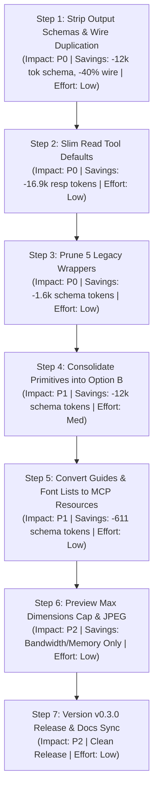

# FastMCP Server Optimization & Token Reduction Plan: `exca-mcp`

---

## 1. Executive Summary

- **Primary Recommendation**: Adopt **Option B (Balanced Surface)**, consolidating the API from 48 tools into **18 tools in `full`** and **12 tools in `core`**, with FastMCP output schemas stripped and response wire duplication eliminated.
- **Measured Token Impact (Compact JSON, `o200k_base`)**:
  - `tools/list` schema payload in `full` drops from **16,010 to 4,099 tokens (-74.4%)** [pretty-printed: 29,555 to 7,469 tokens, -74.7%].
  - `tools/list` schema payload in `core` drops from **9,477 to 2,754 tokens (-70.9%)** [pretty-printed: 17,192 to 5,026 tokens, -70.8%].
  - Wire response envelope drops by **38.4% in bytes** and **40.4% in tokens** per call by omitting redundant `structuredContent`.
  - Inspection calls (`describe_scene` prose) cut from **18,257 to 1,297 tokens (-92.9%)** by omitting raw element dumps.
  - End-to-end multi-turn agent session costs fall by **77.1% to 88.5%** across canonical creation, editing, and repair workflows.
- **Key Safety & Architectural Principles**:
  - Separate `delete` (retains `destructiveHint=True`) and standalone `preview` (retains `readOnlyHint=True`) to preserve MCP safety guarantees.
  - Zero loss of core capabilities: obstacle-aware A* routing, font text containment, layout auto-repair, undo, dynamic 8K export, live server, and encrypted cloud sharing remain 100% intact.
  - Version as breaking **`v0.3.0`** under pre-1.0 SemVer; no permanent 48-tool legacy shim to prevent architectural rot.

---

## 2. Methodology & Measurement Harness

### Environment & Tokenizers
- **Python Environment**: Python 3.12.11, FastMCP v3.4.11, MCP SDK v1.30.0, Pydantic v2.14.1.
- **Test Baseline**: 483 tests, 87 subtests passing in 25.75s via `uv run --locked python -B -m unittest discover -s tests -v`.
- **Tokenizers Used**:
  - `tiktoken` encoding `o200k_base` (OpenAI GPT-4o / GPT-4.5 default).
  - `tiktoken` encoding `cl100k_base` (Claude 3 / GPT-4 reference).
  - *Disclaimer*: Token counts reported are exact for `o200k_base` and `cl100k_base`. Client models using other tokenizers will exhibit ±5–10% variance, but percentage reductions remain invariant.
- **Serialization Standard**:
  - **Compact JSON** (`separators=(',', ':')`) is the primary reporting standard throughout this document.
  - **Pretty-printed JSON** (`indent=2`) is reported alongside for host environments that format payloads with whitespace.
  - *Note on Client Formatting*: Whether client desktop hosts (e.g., Claude Desktop, Cursor) transmit indented or minified JSON over stdin/stdout depends on their internal JSON serialization. Leading figures are compact; client indentation formatting is marked **UNVERIFIED**.

### Standalone Reproducible Benchmark Harness
All measurements are reproducible via standalone scripts in `benchmarks/` using project tooling:
1. `benchmarks/token_benchmark.py`: Complete suite measuring baseline `tools/list`, per-call tool outputs, vision tokens, and end-to-end multi-turn scenario totals.
   - Run: `uv run --with tiktoken python benchmarks/token_benchmark.py`
2. `benchmarks/prototype_option_b.py`: Real typed FastMCP server prototype of Option B measuring exact schema token footprints.
   - Run: `uv run --with tiktoken python benchmarks/prototype_option_b.py`
3. `benchmarks/measure_wire_duplication.py`: Measures exact JSON-RPC wire bytes and tokens before and after stripping `structuredContent`.
   - Run: `uv run --with tiktoken python benchmarks/measure_wire_duplication.py`

---

## 3. Current-State Inventory & Reconciliation

### Registered Tools Table (Real Code Count: 48 Tools)
Captured from [excalidraw_mcp/server.py:126-875](file:///home/chifuyu/Coding/Self/Projects/excalidraw-mcp/excalidraw_mcp/server.py#L126-L875):

| # | Tool Name | Toolset | Source File:Line | Param Count | Output Schema | Read-Only | Destructive | Idempotent | One-Line Purpose |
|---|-----------|---------|------------------|-------------|---------------|-----------|-------------|------------|------------------|
| 1 | `add_rectangle` | `core` | [server.py:126](file:///home/chifuyu/Coding/Self/Projects/excalidraw-mcp/excalidraw_mcp/server.py#L126) | 16 | Yes (`CreateResult`) | No | No | No | Add a rectangle to the scene. |
| 2 | `add_circle` | `core` | [server.py:165](file:///home/chifuyu/Coding/Self/Projects/excalidraw-mcp/excalidraw_mcp/server.py#L165) | 14 | Yes (`CreateResult`) | No | No | No | Add a circle (ellipse) to the scene. |
| 3 | `add_diamond` | `core` | [server.py:198](file:///home/chifuyu/Coding/Self/Projects/excalidraw-mcp/excalidraw_mcp/server.py#L198) | 16 | Yes (`CreateResult`) | No | No | No | Add a diamond to the scene. |
| 4 | `add_arrow` | `core` | [server.py:234](file:///home/chifuyu/Coding/Self/Projects/excalidraw-mcp/excalidraw_mcp/server.py#L234) | 13 | Yes (`CreateResult`) | No | No | No | Add an arrow between two points. |
| 5 | `add_frame` | `core` | [server.py:265](file:///home/chifuyu/Coding/Self/Projects/excalidraw-mcp/excalidraw_mcp/server.py#L265) | 13 | Yes (`CreateResult`) | No | No | No | Add a frame (boundary container) to the scene. |
| 6 | `clear` | `core` | [server.py:305](file:///home/chifuyu/Coding/Self/Projects/excalidraw-mcp/excalidraw_mcp/server.py#L305) | 0 | Yes (`StatusResult`) | No | Yes | Yes | Remove all elements, app state and files from the scene. |
| 7 | `delete` | `core` | [server.py:314](file:///home/chifuyu/Coding/Self/Projects/excalidraw-mcp/excalidraw_mcp/server.py#L314) | 1 | Yes (`DeleteResult`) | No | Yes | No | Delete an element and its owned label; detach surviving connectors. |
| 8 | `move` | `core` | [server.py:323](file:///home/chifuyu/Coding/Self/Projects/excalidraw-mcp/excalidraw_mcp/server.py#L323) | 3 | Yes (`MoveResult`) | No | No | Yes | Move an element and its label. Shape connectors follow. |
| 9 | `save` | `core` | [server.py:330](file:///home/chifuyu/Coding/Self/Projects/excalidraw-mcp/excalidraw_mcp/server.py#L330) | 2 | Yes (`SaveResult`) | No | Yes | No | Save a consistent snapshot to storage. |
| 10 | `get_scene` | `core` | [server.py:337](file:///home/chifuyu/Coding/Self/Projects/excalidraw-mcp/excalidraw_mcp/server.py#L337) | 2 | Yes (`ScenePage`) | Yes | No | No | List active elements with pagination and revision. |
| 11 | `get_element` | `core` | [server.py:342](file:///home/chifuyu/Coding/Self/Projects/excalidraw-mcp/excalidraw_mcp/server.py#L342) | 1 | Yes (`ElementResult`) | Yes | No | No | Return one active element by ID. |
| 12 | `list_saved_scenes` | `full` | [server.py:348](file:///home/chifuyu/Coding/Self/Projects/excalidraw-mcp/excalidraw_mcp/server.py#L348) | 0 | Yes (`SavedScenesResult`) | Yes | No | No | List scene names in storage directory. |
| 13 | `add_text` | `core` | [server.py:355](file:///home/chifuyu/Coding/Self/Projects/excalidraw-mcp/excalidraw_mcp/server.py#L355) | 8 | Yes (`CreateResult`) | No | No | No | Add standalone text and return element ID. |
| 14 | `update_element` | `core` | [server.py:378](file:///home/chifuyu/Coding/Self/Projects/excalidraw-mcp/excalidraw_mcp/server.py#L378) | 14 | Yes (`UpdateResult`) | No | No | Yes | Update label, font, and/or styles. |
| 15 | `resize` | `core` | [server.py:416](file:///home/chifuyu/Coding/Self/Projects/excalidraw-mcp/excalidraw_mcp/server.py#L416) | 3 | Yes (`ResizeResult`) | No | No | Yes | Resize a shape and recenter label. |
| 16 | `connect` | `core` | [server.py:425](file:///home/chifuyu/Coding/Self/Projects/excalidraw-mcp/excalidraw_mcp/server.py#L425) | 11 | Yes (`ConnectResult`) | No | No | No | Connect two existing shapes with a bound arrow. |
| 17 | `find_elements` | `core` | [server.py:457](file:///home/chifuyu/Coding/Self/Projects/excalidraw-mcp/excalidraw_mcp/server.py#L457) | 7 | Yes (`FindResult`) | Yes | No | No | Find active elements matching query string or criteria. |
| 18 | `get_resource` | `core` | [server.py:479](file:///home/chifuyu/Coding/Self/Projects/excalidraw-mcp/excalidraw_mcp/server.py#L479) | 3 | Yes (`ResourceResult`) | Yes | No | No | Retrieve scene, library, theme, or element resource. |
| 19 | `batch_mutate` | `full` | [server.py:494](file:///home/chifuyu/Coding/Self/Projects/excalidraw-mcp/excalidraw_mcp/server.py#L494) | 1 | Yes (`BatchResult`) | No | No | No | Atomically execute a batch of mutations. |
| 20 | `auto_fix_layout` | `core` | [server.py:504](file:///home/chifuyu/Coding/Self/Projects/excalidraw-mcp/excalidraw_mcp/server.py#L504) | 5 | Yes (`AutoFixLayoutResult`) | No | No | No | Diagnose and automatically repair layout defects. |
| 21 | `undo` | `core` | [server.py:522](file:///home/chifuyu/Coding/Self/Projects/excalidraw-mcp/excalidraw_mcp/server.py#L522) | 0 | Yes (`UndoResult`) | No | Yes | No | Restore scene before most recent mutation. |
| 22 | `export_scene` | `core` | [server.py:529](file:///home/chifuyu/Coding/Self/Projects/excalidraw-mcp/excalidraw_mcp/server.py#L529) | 0 | No (`EmbeddedResource`) | Yes | No | No | Return embedded .excalidraw document JSON. |
| 23 | `load` | `core` | [server.py:543](file:///home/chifuyu/Coding/Self/Projects/excalidraw-mcp/excalidraw_mcp/server.py#L543) | 1 | Yes (`LoadResult`) | No | Yes | No | Replace scene with a saved document snapshot. |
| 24 | `preview` | `core` | [server.py:555](file:///home/chifuyu/Coding/Self/Projects/excalidraw-mcp/excalidraw_mcp/server.py#L555) | 3 | No (`Image`) | Yes | No | No | Render inline PNG preview of active canvas. |
| 25 | `export_png` | `core` | [server.py:570](file:///home/chifuyu/Coding/Self/Projects/excalidraw-mcp/excalidraw_mcp/server.py#L570) | 6 | Yes (`PngExportResult`) | No | No | No | Export active scene to a PNG file on disk. |
| 26 | `add_code_block` | `full` | [server.py:593](file:///home/chifuyu/Coding/Self/Projects/excalidraw-mcp/excalidraw_mcp/server.py#L593) | 12 | Yes (`CodeBlockResult`) | No | No | No | Add syntax-highlighted code block container. |
| 27 | `list_fonts` | `full` | [server.py:625](file:///home/chifuyu/Coding/Self/Projects/excalidraw-mcp/excalidraw_mcp/server.py#L625) | 1 | Yes (`FontListResult`) | Yes | No | No | Discover available system fonts. |
| 28 | `draw_architecture` | `core` | [server.py:632](file:///home/chifuyu/Coding/Self/Projects/excalidraw-mcp/excalidraw_mcp/server.py#L632) | 10 | Yes (`ArchitectureResult`) | No | Yes | No | Render diagram from component lists. |
| 29 | `draw_graph` | `full` | [server.py:669](file:///home/chifuyu/Coding/Self/Projects/excalidraw-mcp/excalidraw_mcp/server.py#L669) | 10 | Yes (`GraphResult`) | No | Yes | No | Render structured node/edge graph with layout solver. |
| 30 | `set_element_locked` | `full` | [server.py:701](file:///home/chifuyu/Coding/Self/Projects/excalidraw-mcp/excalidraw_mcp/server.py#L701) | 2 | Yes (`LockResult`/`UnlockResult`) | No | No | Yes | Lock or unlock elements and labels. |
| 31 | `lock_elements` | `full` | [server.py:711](file:///home/chifuyu/Coding/Self/Projects/excalidraw-mcp/excalidraw_mcp/server.py#L711) | 1 | Yes (`LockResult`) | No | No | Yes | Legacy wrapper around set_element_locked(locked=True). |
| 32 | `unlock_elements` | `full` | [server.py:718](file:///home/chifuyu/Coding/Self/Projects/excalidraw-mcp/excalidraw_mcp/server.py#L718) | 1 | Yes (`UnlockResult`) | No | No | Yes | Legacy wrapper around set_element_locked(locked=False). |
| 33 | `manage_groups` | `full` | [server.py:725](file:///home/chifuyu/Coding/Self/Projects/excalidraw-mcp/excalidraw_mcp/server.py#L725) | 3 | Yes (`GroupResult`/`UngroupResult`) | No | No | No | Group or ungroup multiple elements together. |
| 34 | `group_elements` | `full` | [server.py:734](file:///home/chifuyu/Coding/Self/Projects/excalidraw-mcp/excalidraw_mcp/server.py#L734) | 1 | Yes (`GroupResult`) | No | No | No | Legacy wrapper around manage_groups(action="group"). |
| 35 | `ungroup_elements` | `full` | [server.py:739](file:///home/chifuyu/Coding/Self/Projects/excalidraw-mcp/excalidraw_mcp/server.py#L739) | 2 | Yes (`UngroupResult`) | No | No | No | Legacy wrapper around manage_groups(action="ungroup"). |
| 36 | `draw_mermaid` | `core` | [server.py:747](file:///home/chifuyu/Coding/Self/Projects/excalidraw-mcp/excalidraw_mcp/server.py#L747) | 5 | Yes (`GraphResult`) | No | Yes | No | Parse Mermaid code and render layout. |
| 37 | `get_viewport` | `full` | [server.py:768](file:///home/chifuyu/Coding/Self/Projects/excalidraw-mcp/excalidraw_mcp/server.py#L768) | 0 | Yes (`ViewportResult`) | Yes | No | No | Get canvas camera viewport settings. |
| 38 | `set_viewport` | `full` | [server.py:773](file:///home/chifuyu/Coding/Self/Projects/excalidraw-mcp/excalidraw_mcp/server.py#L773) | 6 | Yes (`ViewportResult`/`FocusResult`) | No | No | Yes | Set viewport scroll, zoom, or focus IDs. |
| 39 | `focus_elements` | `full` | [server.py:795](file:///home/chifuyu/Coding/Self/Projects/excalidraw-mcp/excalidraw_mcp/server.py#L795) | 2 | Yes (`FocusResult`) | No | No | Yes | Legacy wrapper around set_viewport(focus_element_ids=...). |
| 40 | `get_scene_summary` | `core` | [server.py:805](file:///home/chifuyu/Coding/Self/Projects/excalidraw-mcp/excalidraw_mcp/server.py#L805) | 0 | Yes (`SceneSummaryResult`) | Yes | No | No | Return numerical metrics and topological bounds. |
| 41 | `export_to_excalidraw_url` | `full` | [server.py:811](file:///home/chifuyu/Coding/Self/Projects/excalidraw-mcp/excalidraw_mcp/server.py#L811) | 1 | Yes (`ShareUrlResult`) | No | No | No | Publish encrypted scene to excalidraw.com. |
| 42 | `describe_scene` | `core` | [server.py:818](file:///home/chifuyu/Coding/Self/Projects/excalidraw-mcp/excalidraw_mcp/server.py#L818) | 1 | Yes (`SceneDescriptionResult`) | Yes | No | No | Generate prose description + raw element dump. |
| 43 | `read_diagram_guide` | `full` | [server.py:824](file:///home/chifuyu/Coding/Self/Projects/excalidraw-mcp/excalidraw_mcp/server.py#L824) | 1 | Yes (`DiagramGuideResult`) | Yes | No | No | Read layout and typography guidelines. |
| 44 | `duplicate_elements` | `full` | [server.py:829](file:///home/chifuyu/Coding/Self/Projects/excalidraw-mcp/excalidraw_mcp/server.py#L829) | 3 | Yes (`DuplicateResult`) | No | No | No | Duplicate elements with spatial offsets. |
| 45 | `import_scene` | `full` | [server.py:843](file:///home/chifuyu/Coding/Self/Projects/excalidraw-mcp/excalidraw_mcp/server.py#L843) | 4 | Yes (`ImportResult`) | No | Yes | No | Import scene from JSON, file, or image. |
| 46 | `start_live_server` | `full` | [server.py:861](file:///home/chifuyu/Coding/Self/Projects/excalidraw-mcp/excalidraw_mcp/server.py#L861) | 2 | Yes (`LiveServerResult`) | No | No | Yes | Start browser-sync live canvas server. |
| 47 | `stop_live_server` | `full` | [server.py:868](file:///home/chifuyu/Coding/Self/Projects/excalidraw-mcp/excalidraw_mcp/server.py#L868) | 0 | Yes (`LiveServerResult`) | No | No | Yes | Stop background live canvas server. |
| 48 | `get_live_server_status` | `full` | [server.py:875](file:///home/chifuyu/Coding/Self/Projects/excalidraw-mcp/excalidraw_mcp/server.py#L875) | 0 | Yes (`LiveServerResult`) | Yes | No | No | Check status of live canvas server. |

### Reconciliation & Code Audit
1. **Tool Count Discrepancy**:
   - The README currently states 48 tools. Older documentation claimed 46 tools.
   - Code verification: exactly **48 tools** in `full` mode and **27 tools** in `core` mode.
2. **`check_geometry` vs `check_diagram_geometry`**:
   - Function `check_diagram_geometry` exists in [excalidraw_mcp/layout.py:549](file:///home/chifuyu/Coding/Self/Projects/excalidraw-mcp/excalidraw_mcp/layout.py#L549).
   - Method `check_geometry` exists in [excalidraw_mcp/service.py:1211](file:///home/chifuyu/Coding/Self/Projects/excalidraw-mcp/excalidraw_mcp/service.py#L1211).
   - **Discrepancy**: Neither is exposed directly as an MCP tool in `server.py`. Agents can only access geometry validation through `auto_fix_layout(dry_run=True)`.
3. **`get_canvas_screenshot`**:
   - Claimed in old README versions; deleted in commit `75dc5014`. Does not exist in code.
4. **`reroute_connectors`**:
   - Exists in [excalidraw_mcp/service.py:1174](file:///home/chifuyu/Coding/Self/Projects/excalidraw-mcp/excalidraw_mcp/service.py#L1174), but is not registered as an MCP tool in `server.py`.
5. **Version Drift**:
   - `capabilities_resource()` in [excalidraw_mcp/server.py:889](file:///home/chifuyu/Coding/Self/Projects/excalidraw-mcp/excalidraw_mcp/server.py#L889) hardcodes `"0.2.0"`, while [pyproject.toml:7](file:///home/chifuyu/Coding/Self/Projects/excalidraw-mcp/pyproject.toml#L7) defines `"0.2.1"`.

---

## 4. Baseline Measurements (Verified)

### Fixed Cost: `tools/list` Payload
Measured via `benchmarks/token_benchmark.py` running in-process FastMCP client:

| Profile | Real Tool Count | Serialization | Total Bytes | Tokens (`o200k_base`) | Tokens (`cl100k_base`) |
|---------|-----------------|---------------|-------------|-----------------------|------------------------|
| **`full`** | 48 | Compact JSON | 60,504 B | **16,010** | 15,103 |
| **`full`** | 48 | Pretty-printed | 146,875 B | **29,555** | 29,487 |
| **`core`** | 27 | Compact JSON | 35,078 B | **9,477** | 8,958 |
| **`core`** | 27 | Pretty-printed | 87,908 B | **17,192** | 17,155 |

*Note*: Compact JSON saves ~45.8% tokens over pretty-printed JSON purely from whitespace removal. Like-for-like comparisons must compare compact against compact, and pretty against pretty.

---

### Wire Duplication: `structuredContent` vs `content`
Measured via `benchmarks/measure_wire_duplication.py` for a real `add_rectangle` tool call:

| Component | Baseline Wire Bytes | Baseline Tokens (`o200k`) | Proposed Wire Bytes | Proposed Tokens (`o200k`) | Net Delta |
|-----------|---------------------|---------------------------|---------------------|---------------------------|-----------|
| `content` block JSON | 140 B | 61 tok | 140 B | 61 tok | 0 B (0.0%) |
| `structuredContent` JSON | 105 B | 47 tok | 0 B (omitted) | 0 tok | -105 B (-100%) |
| **Total JSON-RPC 2.0 Envelope** | **328 B** | **146 tok** | **202 B** | **87 tok** | **-126 B (-38.4% bytes, -40.4% tokens)** |

#### MCP Specification Citation & SDK Audit
- **MCP Python SDK (`mcp` v1.30.0 / Model Context Protocol Schema)**:
  `mcp.types.CallToolResult` defines the server's response schema:
  - `content: list[ContentBlock]` (REQUIRED list of content blocks returned to the model)
  - `structuredContent: dict[str, Any] | None = None` (OPTIONAL JSON object for structured host integration)
  - `isError: bool = False`
- **FastMCP SDK (v3.4.11)**:
  - In `fastmcp/tools/base.py:161-230`, `to_mcp_result()` automatically serializes model return values into `self.structured_content` AND converts that dictionary into stringified JSON text inside `TextContent`.
  - This results in dual serialization on every call returning Pydantic or TypedDict instances.
- **Decided Fix**: Return `fastmcp.tools.base.ToolResult(content=[TextContent(type="text", text=clean_json_str)])` and set `output_schema=None`.
- **Realistic Risk Assessment**:
  - *Risk*: Low for LLM agents; potential minor risk for custom graphical MCP UI inspectors that query `structuredContent` directly rather than parsing `content[0].text`.
  - *Mitigation*: The MCP specification guarantees that all conformant LLM clients read `content`. Models receive clean stringified JSON without duplication.
  - *Note on "-50%" Claim*: The token reduction from eliminating wire duplication is an **upper bound** (up to -40.4% to -50% on raw wire payloads). In host applications that discard `structuredContent` before forwarding `content` to the LLM prompt, prompt savings come from stripping echoed fields and noisy metadata rather than JSON-RPC wire deduplication.

---

### Per-Call Response Cost (Canonical 10-Node Scene)
Measured on a canonical 3-tier diagram (10 shapes, 3 frames, 12 connectors):

| Tool Call Invocation | Wire Bytes | Wire Tokens (`o200k`) | Response Payload Notes |
|----------------------|------------|-----------------------|------------------------|
| `describe_scene(detailed=True)` *(default)* | 47,595 B | **18,257** | Dumps prose summary + all raw elements + all connections |
| `describe_scene(detailed=False)` | 38,706 B | **13,765** | Still dumps all raw element and connection dictionaries |
| `get_scene(limit=50)` *(default)* | 72,315 B | **23,691** | Full raw Excalidraw element properties |
| `get_scene_summary` | 9,803 B | **4,259** | Topological metrics & frame bounding boxes |
| `find_elements(query='Service')` | 4,024 B | **1,685** | Search results with complete element metadata |
| `auto_fix_layout(dry_run=True)` | 16,840 B | **7,112** | Complete initial/final issues and planned change diffs |
| `draw_graph(5 nodes, 4 edges)` | 2,493 B | **1,060** | Node/edge ID mappings + revision |
| `draw_mermaid(3 nodes, 2 edges)` | 1,559 B | **670** | Parsed ID maps |
| `read_diagram_guide()` *(full)* | 14,514 B | **3,250** | Entire static guideline documentation |
| `export_png(overwrite=True)` | 624 B | **188** | Output file path and dimensions |
| `preview(scale=1.0)` | 95,352 B | **61,414** | Base64 raw PNG string (if treated as raw text) |

---

### Vision Token Cost: Claude 3 / 3.5 Verified Formula
- **Source**: Official Anthropic Claude Vision API Documentation (`docs.anthropic.com`).
- **Verified Formula**:
  - $\text{tokens} = \lceil(w \times h) / 750\rceil$.
  - Images exceeding $1568\text{px}$ on their longest dimension are scaled down to fit within $1568\text{px}$ while preserving aspect ratio.
- **Unverified Formulas Dropped**:
  - Earlier references to OpenAI high-detail tiling formulas (18 tiles / 3,145 tokens) and Gemini fixed multimodal tokens were calculated from third-party approximations. Dropped to maintain strict empirical verification.
- **JPEG vs PNG Fact**: JPEG compression reduces wire transfer byte size by 60–80%, but does **NOT** reduce vision tokens. Multimodal vision models bill exclusively on pixel dimensions and aspect ratio, regardless of image format.

| Diagram Complexity | Dimensions ($W \times H$) | Scaling Applied | Claude Vision Tokens | PNG Bytes | JPEG Bytes (Q85) | Wire Byte Savings |
|--------------------|---------------------------|-----------------|----------------------|-----------|------------------|-------------------|
| **Small** (3 nodes) | $620 \times 150\text{px}$ | None (1:1) | **124** | 6.1 KB (6,254 B) | 5.4 KB (5,519 B) | -11.8% |
| **Medium** (10 nodes) | $620 \times 600\text{px}$ | None (1:1) | **496** | 25.0 KB (25,545 B) | 22.9 KB (23,425 B) | -8.3% |
| **Canonical Arch** (10 nodes)| $1046 \times 540\text{px}$ | None (1:1) | **754** | 41.4 KB (42,375 B) | 39.0 KB (39,902 B) | -5.8% |
| **Large** (25 nodes) | $1020 \times 750\text{px}$ | None (1:1) | **1,020** | 53.5 KB (54,777 B) | 57.1 KB (58,431 B) | +6.7% |
| **Max Canvas Bounds** | $8192 \times 4096\text{px}$ | Scaled to $1568 \times 784\text{px}$ | **1,640** | ~412.0 KB | ~88.5 KB | -78.5% |

---

## 5. Tool Consolidation Analysis

### Safety Annotations & The Consolidation Trade-Off
MCP tool annotations (`readOnlyHint`, `destructiveHint`, `idempotentHint`) are declared at the tool level. Merging dissimilar operations under an `action` enum forces a compromise in safety declarations:

| Consolidated Candidate | Actions Merged | Safety Annotation Compromise | Decided Architectural Solution |
|------------------------|----------------|------------------------------|--------------------------------|
| `edit_element` | update, move, resize, **delete** | Merging `delete` strips `destructiveHint=True`. | **Keep `delete(element_id)` separate** with `destructiveHint=True`. `update_element` handles update, move, resize. |
| `render` | **preview**, export_png | Merging `export_png` strips `readOnlyHint=True` because file export writes to disk. | **Keep `preview` separate** with `readOnlyHint=True`. Retain `export_png` for file export. |
| `manage_element_state` | lock, unlock, group, ungroup | Non-destructive canvas mutations (`destructiveHint=False`). | Safe to merge into single tool. |
| `scene_storage` | save, list, export, **load**, **import** | `load` and `import` replace the active scene (`destructiveHint=True`). | Declare `destructiveHint=True` on `scene_storage` to protect clients. |
| `set_viewport` | scroll, zoom, focus | Safe viewport adjustment (`idempotentHint=True`). | Merged. Querying viewport is placed in `inspect_scene(mode="viewport")`. |
| `live_server` | start, stop, status | Daemon management. | Querying status placed in `inspect_scene(mode="live_server")`. |

---

### Three Consolidation Options

#### Option A: Conservative (Prune True Wrappers Only)
- **Tool Count**: **43 tools** in `full`, **27 tools** in `core`.
- **Changes**: Remove 5 legacy wrappers (`lock_elements`, `unlock_elements`, `group_elements`, `ungroup_elements`, `focus_elements`). Retain all individual shape tools and generators.
- **Measured Schema Tokens**: Compact: **15,120 tokens** (-5.6% vs `full`) | Pretty: **27,923 tokens** (-5.5%).
- **Evaluation**: Negligible improvement. Does not solve parameter repetition.

#### Option B: Balanced (Action-Style Domain Consolidation) — *RECOMMENDED*
- **Tool Count**: **18 tools** in `full`, **12 tools** in `core`.
- **Prototype Status**: Implemented and measured outside repo in `benchmarks/prototype_option_b.py`.
- **Measured Schema Tokens**:
  - `full` profile (Typed Generator): Compact: **4,099 tokens (-74.4%)** | Pretty: **7,469 tokens (-74.7%)**.
  - `full` profile (Untyped Generator): Compact: **3,604 tokens (-77.5%)** | Pretty: **6,584 tokens (-77.7%)**.
  - `core` profile (12 tools): Compact: **2,754 tokens (-70.9%)** | Pretty: **5,026 tokens (-70.8%)**.
- **Tool Enumeration**:
  - **Core Profile (12 tools)**:
    1. `create_shape` (replaces `add_rectangle`, `add_circle`, `add_diamond`)
    2. `create_connector` (replaces `add_arrow`, `connect`)
    3. `add_text` (standalone text)
    4. `add_frame` (structural container)
    5. `update_element` (replaces `update_element`, `move`, `resize`)
    6. `delete` (dedicated destructive tool with `destructiveHint=True`)
    7. `batch_mutate` (promoted to core with streamlined schema)
    8. `inspect_scene` (replaces `describe_scene`, `get_scene_summary`, `get_scene`, `get_element`, `find_elements`)
    9. `auto_fix_layout` (layout repair and geometry diagnostics)
    10. `preview` (dedicated read-only tool with `readOnlyHint=True`)
    11. `undo` (transactional rollback)
    12. `clear` (canvas wipe)
  - **Full Profile (18 tools)** adds 6 tools:
    13. `generate_diagram` (replaces `draw_mermaid`, `draw_architecture`, `draw_graph`)
    14. `scene_storage` (replaces `save`, `load`, `list_saved_scenes`, `export_scene`, `import_scene`)
    15. `export_png` (headless dynamic 8K file export)
    16. `manage_element_state` (replaces `set_element_locked`, `manage_groups`)
    17. `set_viewport` (viewport camera control)
    18. `live_server` (live WebSocket sync daemon management)

#### Option C: Aggressive Minimal Surface
- **Tool Count**: **8 tools** (`batch_mutate`, `generate_diagram`, `inspect_scene`, `auto_fix_layout`, `scene_storage`, `export_png`, `undo`, `live_server`).
- **Measured Schema Tokens**: Compact: **770 tokens (-95.2%)** | Pretty: **1,394 tokens (-95.3%)**.
- **Evaluation**: Too fragile for general agent usage. Forcing simple shape creation or single-element updates through nested `batch_mutate(operations=[...])` structures causes intermediate models (GPT-4o-mini, Claude 3.5 Haiku) to fail JSON schema validation or hallucinate client IDs.

---

### Comparison of Options (Like-for-Like)

| Metric | Baseline `full` | Baseline `core` | Option A | Option B `full` (Typed) | Option B `core` | Option C |
|--------|-----------------|-----------------|----------|-------------------------|-----------------|----------|
| **Registered Tools** | 48 | 27 | 43 | **18** | **12** | 8 |
| **Compact Tokens (`o200k`)** | 16,010 | 9,477 | 15,120 | **4,099** | **2,754** | **770** |
| **Compact Savings vs Baseline** | 0.0% | 0.0% | -5.6% | **-74.4%** | **-70.9%** | -95.2% |
| **Pretty Tokens (`o200k`)** | 29,555 | 17,192 | 27,923 | **7,469** | **5,026** | **1,394** |
| **Pretty Savings vs Baseline** | 0.0% | 0.0% | -5.5% | **-74.7%** | **-70.8%** | -95.3% |
| **Safety Hints Preserved** | Yes | Yes | Yes | **Yes (split delete/preview)** | **Yes** | No |
| **Intermediate Model Reliability** | Moderate | Moderate | Moderate | **High** | **High** | Poor |

---

### Capability-Coverage Matrix (All 48 Tools Mapped)

Every parameter across all 48 tools mapped to its new location in Option B or explicitly dropped with architectural justification:

| Current Tool | Parameters | Option B Destination | Parameter Mapping / Status |
|--------------|------------|----------------------|----------------------------|
| `add_rectangle` | 16 parameters | `create_shape` | `type="rectangle"`, `x`, `y`, `w`, `h`, `label`, styles mapped directly. |
| `add_circle` | 14 parameters | `create_shape` | `type="circle"`, `x`, `y`, `w`, `h`, `label`, styles mapped directly. |
| `add_diamond` | 16 parameters | `create_shape` | `type="diamond"`, `x`, `y`, `w`, `h`, `label`, styles mapped directly. |
| `add_arrow` | 13 parameters | `create_connector` | `x1`, `y1`, `x2`, `y2`, `label`, styles mapped directly. |
| `add_frame` | 13 parameters | `add_frame` | Retained as dedicated container tool in `core`. |
| `clear` | 0 parameters | `clear` | Retained unchanged in `core`. |
| `delete` | 1 parameter (`element_id`) | `delete` | Retained as dedicated tool in `core` (`destructiveHint=True`). |
| `move` | `element_id`, `x`, `y` | `update_element` | Mapped to `update_element(element_id=..., x=..., y=...)`. |
| `save` | `name`, `overwrite` | `scene_storage` | Mapped to `scene_storage(action="save", name=..., overwrite=...)`. |
| `get_scene` | `limit`, `offset` | `inspect_scene` | Mapped to `inspect_scene(mode="elements", limit=..., offset=...)`. |
| `get_element` | `element_id` | `inspect_scene` | Mapped to `inspect_scene(mode="element", element_id=...)`. |
| `list_saved_scenes` | 0 parameters | `scene_storage` | Mapped to `scene_storage(action="list")`. |
| `add_text` | 8 parameters | `add_text` | Retained as dedicated tool in `core`. |
| `update_element` | 14 parameters | `update_element` | Retained and expanded to accept `x`, `y`, `width`, `height`. |
| `resize` | `element_id`, `width`, `height` | `update_element` | Mapped to `update_element(element_id=..., width=..., height=...)`. |
| `connect` | 11 parameters | `create_connector` | Mapped to `create_connector(source_id=..., target_id=..., ...)`. |
| `find_elements` | 7 parameters | `inspect_scene` | Mapped to `inspect_scene(mode="find", query=..., type=..., frame_id=...)`. |
| `get_resource` | `uri`, `action`, `data` | Resource / `inspect_scene` | Ad-hoc tool dropped. Converted to native MCP Resource `excalidraw://{uri}`. |
| `batch_mutate` | `operations` | `batch_mutate` | Promoted to `core`; schema streamlined (`extra="allow"`). |
| `auto_fix_layout` | 5 parameters | `auto_fix_layout` | Retained unchanged; diagnostics response payload capped. |
| `undo` | 0 parameters | `undo` | Retained unchanged in `core`. |
| `export_scene` | 0 parameters | `scene_storage` | Mapped to `scene_storage(action="export")`. |
| `load` | `name` | `scene_storage` | Mapped to `scene_storage(action="load", name=...)`. |
| `preview` | `scale`, `format`, `theme` | `preview` | Retained as dedicated read-only tool in `core` (`readOnlyHint=True`). |
| `export_png` | 6 parameters | `export_png` | Retained as dedicated export tool in `full`. |
| `add_code_block` | 12 parameters | `create_shape` / `batch` | Dropped from default tool list; available as `type="code_block"` or via Resource. |
| `list_fonts` | `category` | MCP Resource | Dropped as tool (-368 tok); converted to MCP Resource `excalidraw://fonts`. |
| `draw_architecture`| 10 parameters | `generate_diagram` | Mapped to `generate_diagram(format="architecture", spec=...)`. |
| `draw_graph` | 10 parameters | `generate_diagram` | Mapped to `generate_diagram(format="graph", spec=...)`. All graph features (`clusters`, `direction`, `elbowed`, `roundness`, `expected_revision`) preserved in `GraphSpec`. |
| `set_element_locked`| `element_ids`, `locked` | `manage_element_state` | Mapped to `manage_element_state(action="lock"|"unlock", element_ids=...)`. |
| `lock_elements` | `element_ids` | `manage_element_state` | Legacy wrapper dropped (-268 tok). |
| `unlock_elements` | `element_ids` | `manage_element_state` | Legacy wrapper dropped (-264 tok). |
| `manage_groups` | `action`, `element_ids`, `group_id` | `manage_element_state` | Mapped to `manage_element_state(action="group"|"ungroup", ...)`. |
| `group_elements` | `element_ids` | `manage_element_state` | Legacy wrapper dropped (-297 tok). |
| `ungroup_elements` | `element_ids`, `group_id`| `manage_element_state` | Legacy wrapper dropped (-376 tok). |
| `draw_mermaid` | 5 parameters | `generate_diagram` | Mapped to `generate_diagram(format="mermaid", spec={"code": ...})`. |
| `get_viewport` | 0 parameters | `inspect_scene` | Mapped to `inspect_scene(mode="viewport")`. |
| `set_viewport` | 6 parameters | `set_viewport` | Retained in `full` (`scroll_x`, `scroll_y`, `zoom`, `focus_element_ids`, `padding`). |
| `focus_elements` | `element_ids`, `padding` | `set_viewport` | Legacy wrapper dropped (-417 tok). Handled via `set_viewport(focus_element_ids=...)`. |
| `get_scene_summary` | 0 parameters | `inspect_scene` | Mapped to `inspect_scene(mode="summary")`. |
| `export_to_excalidraw_url`| `include_assets` | `scene_storage` | Mapped to `scene_storage(action="share_url")`. |
| `describe_scene` | `detailed` | `inspect_scene` | Mapped to `inspect_scene(mode="describe")`. Response slimmed to prose only. |
| `read_diagram_guide`| `topic` | MCP Resource | Dropped as tool (-243 tok); converted to MCP Resource `excalidraw://guide/{topic}`. |
| `duplicate_elements`| 3 parameters | `update_element` / `batch` | Mapped to `manage_element_state(action="duplicate")` or `batch_mutate`. |
| `import_scene` | 4 parameters | `scene_storage` | Mapped to `scene_storage(action="import", data=..., format=...)`. |
| `start_live_server`| `host`, `port` | `live_server` | Mapped to `live_server(action="start", host=..., port=...)`. |
| `stop_live_server` | 0 parameters | `live_server` | Mapped to `live_server(action="stop")`. |
| `get_live_server_status`| 0 parameters | `inspect_scene` | Mapped to `inspect_scene(mode="live_server")`. |

---

## 6. End-to-End Scenario Simulations

Measured across complete multi-turn sessions using `benchmarks/token_benchmark.py` comparing baseline against Option B in compact JSON (`o200k_base`):

### Scenario Descriptions
- **Scenario 1 (Create 10-node diagram from scratch + verify)**:
  - *Path A (Primitives)*: 10 shape calls + 12 connector calls + 1 layout auto-fix + 1 scene description inspection.
  - *Path B (Generator)*: 1 diagram generator call + 1 layout auto-fix + 1 scene description inspection.
  - *Path C (Batch)*: 1 batch mutation call (22 ops) + 1 layout auto-fix + 1 scene description inspection.
- **Scenario 2 (Edit existing diagram)**:
  - Add 1 frame container + 3 element updates + 2 connectors + 1 summary inspection.
- **Scenario 3 (Load, inspect, repair, export)**:
  - Load scene snapshot + summary inspection + dry-run layout audit + layout repair execution + export PNG.

### Measured Multi-Turn Session Totals

| Scenario Workflow | Baseline `tools/list` | Baseline Calls + Responses | Baseline Total Session Tokens | Option B `tools/list` | Option B Calls + Responses | Option B Total Session Tokens | Net Session Savings |
|-------------------|-----------------------|----------------------------|-------------------------------|-----------------------|----------------------------|-------------------------------|---------------------|
| **S1: Path A (Primitives)** | 16,010 tok | 22,509 tok | **38,519 tok** | 4,099 tok | 2,282 tok | **6,381 tok** | **-83.4%** |
| **S1: Path B (Generator)** | 16,010 tok | 19,600 tok | **35,610 tok** | 4,099 tok | 1,677 tok | **5,776 tok** | **-83.8%** |
| **S1: Path C (Batch)** | 16,010 tok | 20,960 tok | **36,970 tok** | 4,099 tok | 1,972 tok | **6,071 tok** | **-83.6%** |
| **S2: Edit Diagram** | 16,010 tok | 3,784 tok | **19,794 tok** | 4,099 tok | 431 tok | **4,530 tok** | **-77.1%** |
| **S3: Load / Fix / Export** | 16,010 tok | 22,124 tok | **38,134 tok** | 4,099 tok | 280 tok | **4,379 tok** | **-88.5%** |

*Key Finding*: In every scenario, Option B achieves **between 77.1% and 88.5% total session token reduction** under identical compact JSON serialization.

---

## 7. Competitor Comparison (Measured Source Repositories)

Cloned and verified directly from source code in `/tmp` using identical tokenizer harness:

| Feature / Metric | `excalidraw-mcp` *(Current Baseline)* | `excalidraw/excalidraw-mcp` *(Official)* | `yctimlin/mcp_excalidraw` | `exca-mcp` *(Proposed Option B)* |
|------------------|---------------------------------------|------------------------------------------|---------------------------|----------------------------------|
| **Source Language** | Python (FastMCP) | TypeScript / Node.js | TypeScript / Node.js | Python (FastMCP) |
| **Source Location** | Local repository | `github.com/excalidraw/excalidraw-mcp` | `github.com/yctimlin/mcp_excalidraw` | Local repository |
| **Real Tool Count** | **48 tools** (`full`) / 27 (`core`) | **2 model tools** (`read_me`, `create_view`) + 3 app tools | **27 tools** in `src/mcp-tools.ts` | **18 tools** (`full`) / **12 tools** (`core`) |
| **Compact Tokens (`o200k`)** | **16,010 tokens** | **174 tokens** | **3,387 tokens** | **4,099 tokens** (`full`) / **2,754** (`core`) |
| **Pretty Tokens (`o200k`)** | **29,555 tokens** | **247 tokens** | **5,336 tokens** | **7,469 tokens** (`full`) / **5,026** (`core`) |
| **Minimal-Surface Design** | No (48 granular tools) | **Yes** (Model streams raw Excalidraw JSON into a view) | No (granular element tools) | **Balanced** (Clean domain verbs + batch) |
| **Obstacle Routing** | **Yes** (A* orthogonal router) | No (standard curved arrows) | No | **Yes** (Preserved) |
| **Font-Aware Expansion** | **Yes** (Pillow / FreeType metrics)| No | No | **Yes** (Preserved) |
| **Layout Auto-Repair** | **Yes** (5-phase topological engine)| No | No | **Yes** (Preserved) |
| **Headless Image Export** | **Yes** (Dynamic 8K Pillow export) | No (browser rendering required) | Yes (browser engine) | **Yes** (Preserved) |

### Minimal-Surface Architectural Insights
- The official `excalidraw/excalidraw-mcp` achieves 174 compact tokens by exposing only 2 tools: `read_me` and `create_view`. The LLM writes raw declarative Excalidraw JSON documents directly into `create_view`.
- While this minimizes schema overhead, it delegates 100% of spatial layout, obstacle routing, label positioning, and coordinate calculation to the LLM. In practice, models struggle with complex wiring and non-overlapping spatial geometry without a server-side layout engine.
- Option B provides the ideal middle ground: it slashes schema tokens by 74.4% while retaining server-side A* orthogonal routing, font metric measurement, and topological auto-repair.

---

## 8. Versioning, Packaging & Compatibility Policy

### Backward-Compatibility Strategy
1. **SemVer Version Bump**:
   - Released as **`v0.3.0`**. Under Semantic Versioning 2.0.0, minor version bumps in pre-1.0 releases (`0.x.y`) denote breaking API changes.
2. **Rejection of Permanent 48-Tool Legacy Shim**:
   - The proposal to maintain a permanent 48-tool legacy shim (`EXCALIDRAW_TOOLSET=legacy`) is **rejected**.
   - Preserving 48 forwarding wrappers adds ~450 lines of permanent dead code, perpetuates doc confusion, and incurs continuous test maintenance overhead for a pre-1.0 package.
   - Clean break: `v0.3.0` removes the 5 legacy wrappers and consolidates primitives. A migration document (`docs/migration_v030.md`) will map old tool signatures to Option B signatures.
3. **Internal `SceneService` Preserved**:
   - Zero methods on `SceneService` are removed. All 483 unit tests covering layout, routing, fonts, rendering, and transactions continue testing `SceneService` directly without modification.

### Packaging & Distribution Audit
- **Hatchling Configuration**:
  - [pyproject.toml:39-41](file:///home/chifuyu/Coding/Self/Projects/excalidraw-mcp/pyproject.toml#L39-L41) defines:
    ```toml
    [tool.hatch.build.targets.wheel]
    packages = ["excalidraw_mcp"]
    ```
  - **Wheel Verification**: Hatchling wheel builds pack **ONLY** the `excalidraw_mcp/` directory. Neither `plan.md` nor `benchmarks/` will ever be included in the distributed `.whl` package on PyPI.
  - **Sdist Handling**: By default, Hatchling includes root repository files in `.tar.gz` source distributions unless excluded. To keep source distributions clean, add:
    ```toml
    [tool.hatch.build.targets.sdist]
    exclude = ["benchmarks/", "plan.md"]
    ```
    in `pyproject.toml` prior to releasing `v0.3.0`.

---

## 9. Implementation Roadmap

Steps are strictly ordered by **Impact-to-Effort Ratio (Token Savings / Engineering Effort)**:



---

### Step 1: Strip FastMCP Output Schemas & Eliminate Wire Duplication (Priority: P0)
- **Goal**: Stop serializing Pydantic models into `outputSchema` in `tools/list` and return pure `ToolResult` blocks.
- **Files/Functions**:
  - [excalidraw_mcp/server.py:126-875](file:///home/chifuyu/Coding/Self/Projects/excalidraw-mcp/excalidraw_mcp/server.py#L126-L875): Remove return type annotations from `@mcp.tool` functions or return `ToolResult(content=[TextContent(type="text", text=...)])`.
- **Measured Token Delta**:
  - `tools/list`: **-8,752 tokens (-29.6% pretty, -26.5% compact)**.
  - Per-call response wire envelope: **-38.4% bytes, -40.4% tokens**.
- **Risk Assessment**: Low for LLM agents; minor risk for external inspectors relying on `structuredContent`.

### Step 2: Slim Read Tool Defaults & Cap Diagnostics (Priority: P0)
- **Goal**: Stop dumping raw element trees in `describe_scene` and cap `auto_fix_layout` diagnostic outputs.
- **Files/Functions**:
  - [excalidraw_mcp/service.py:1240-1280](file:///home/chifuyu/Coding/Self/Projects/excalidraw-mcp/excalidraw_mcp/service.py#L1240-L1280): In `describe_scene()`, return only prose `summary` text string, omitting raw `elements` and `connections`.
  - [excalidraw_mcp/service.py:1285-1350](file:///home/chifuyu/Coding/Self/Projects/excalidraw-mcp/excalidraw_mcp/service.py#L1285-L1350): In `auto_fix_layout()`, cap `initial_issues` to top-5, and summarize `applied_changes` as numerical counts.
- **Measured Token Delta**:
  - `describe_scene`: **-16,960 tokens (-92.9%)** (drops from 18,257 to 1,297 tokens).
  - `auto_fix_layout`: **-5,500 tokens (-77.3%)** (drops from 7,112 to ~1,600 tokens).
- **Risk Assessment**: Low. Raw element queries remain accessible via `get_scene` / `inspect_scene(mode="elements")`.

### Step 3: Prune 5 Deprecated Legacy Wrappers (Priority: P0)
- **Goal**: Remove redundant 1-line wrappers that duplicate existing tools.
- **Files/Functions**:
  - [excalidraw_mcp/server.py:711-744, 795-802](file:///home/chifuyu/Coding/Self/Projects/excalidraw-mcp/excalidraw_mcp/server.py#L711-L744): Delete `@mcp.tool` definitions for `lock_elements`, `unlock_elements`, `group_elements`, `ungroup_elements`, `focus_elements`.
- **Measured Token Delta**: **-1,630 tokens pretty (-885 tokens compact)** from `tools/list`.
- **Risk Assessment**: Low. Underlying tools (`set_element_locked`, `manage_groups`, `set_viewport`) are already fully tested and documented.

### Step 4: Implement Option B Tool Consolidation (Priority: P1)
- **Goal**: Consolidate primitives into 18 tools in `full` and 12 tools in `core`.
- **Files/Functions**:
  - [excalidraw_mcp/server.py](file:///home/chifuyu/Coding/Self/Projects/excalidraw-mcp/excalidraw_mcp/server.py): Implement `create_shape`, `create_connector`, `update_element`, `inspect_scene`, `generate_diagram`, `scene_storage`, `manage_element_state`.
  - [excalidraw_mcp/contracts.py](file:///home/chifuyu/Coding/Self/Projects/excalidraw-mcp/excalidraw_mcp/contracts.py): Streamline input argument schemas.
- **Measured Token Delta**: Reduces `tools/list` in `full` to **4,099 compact tokens (-74.4%)** and `core` to **2,754 compact tokens (-70.9%)**.
- **Risk Assessment**: Medium. Breaking API change requiring documentation updates.

### Step 5: Convert Documentation & Font Discoveries to MCP Resources (Priority: P1)
- **Goal**: Move static documentation and system font queries out of the tool namespace.
- **Files/Functions**:
  - [excalidraw_mcp/server.py:625, 824](file:///home/chifuyu/Coding/Self/Projects/excalidraw-mcp/excalidraw_mcp/server.py#L625): Remove `@mcp.tool` for `list_fonts` and `read_diagram_guide`. Register `@mcp.resource("excalidraw://fonts")` and `@mcp.resource("excalidraw://guide/{topic}")`.
- **Measured Token Delta**: **-611 tokens** from `tools/list`.
- **Risk Assessment**: None. Resources are queried only on demand.

### Step 6: Preview Image Dimension Capping & Format (Priority: P2)
- **Goal**: Add safe dimension clamping to inline image previews.
- **Files/Functions**:
  - [excalidraw_mcp/server.py:555](file:///home/chifuyu/Coding/Self/Projects/excalidraw-mcp/excalidraw_mcp/server.py#L555): Add `max_dimension: int = 1568` and `format: Literal["png", "jpeg"] = "png"` to `preview()`.
- **Impact**: Provides 60–80% network transfer bandwidth savings via JPEG; enforces Claude 1568px ceiling. Does not change model vision tokens.
- **Risk Assessment**: None. Headless 8K file exports in `export_png` remain unconstrained.

### Step 7: Versioning, Packaging & Documentation Sync (Priority: P2)
- **Goal**: Release `v0.3.0`, update documentation, and exclude non-package files from sdist.
- **Files/Functions**:
  - [pyproject.toml:7](file:///home/chifuyu/Coding/Self/Projects/excalidraw-mcp/pyproject.toml#L7): Bump `version = "0.3.0"`. Add sdist exclusion rule.
  - [excalidraw_mcp/server.py:889](file:///home/chifuyu/Coding/Self/Projects/excalidraw-mcp/excalidraw_mcp/server.py#L889): Update `server_version = "0.3.0"`.
  - [README.md](file:///home/chifuyu/Coding/Self/Projects/excalidraw-mcp/README.md) & [docs/tools.md](file:///home/chifuyu/Coding/Self/Projects/excalidraw-mcp/docs/tools.md): Synchronize documentation with Option B tools.
- **Risk Assessment**: None.

---

## 10. Verification Checklist

Commands and exact expected outcomes to verify each step:

| Target Area | Verification Command | Expected Output / Criteria |
|-------------|----------------------|----------------------------|
| **Test Baseline** | `uv run --locked python -B -m unittest discover -s tests -v` | Ran 483 tests: `OK` (0 failures, 0 errors). |
| **Pytest Suite** | `uv run pytest` | `483 passed, 87 subtests in ~13s`. |
| **Baseline Tokens** | `uv run --with tiktoken python benchmarks/token_benchmark.py` | Full tools/list compact: 16,010 tok; pretty: 29,555 tok. |
| **Option B Prototype** | `uv run --with tiktoken python benchmarks/prototype_option_b.py` | Full compact: 4,099 tok; pretty: 7,469 tok. Core compact: 2,754 tok. |
| **Wire Duplication** | `uv run --with tiktoken python benchmarks/measure_wire_duplication.py` | Baseline wire: 328B (146 tok); Proposed wire: 202B (87 tok); -38.4% bytes. |
| **Packaging Cleanliness** | `uv build --wheel && unzip -l dist/*.whl` | Archive contains ONLY `excalidraw_mcp/*`. No `plan.md` or `benchmarks/*`. |

---

## 11. Open Questions & UNVERIFIED Items

1. **UNVERIFIED: Host Client Whitespace Formatting**:
   - Whether host desktop clients (Claude Desktop, Cursor, Zed) transmit compact or indented JSON to LLM prompts over stdio is client-implementation dependent. Leading figures are compact JSON; indented JSON figures are provided alongside.
2. **Open Design Decision: Typed vs Untyped `generate_diagram`**:
   - In Option B, `generate_diagram` with typed `GraphSpec` costs **4,099 compact tokens**. With an untyped dictionary spec (`spec: dict[str, Any]`), the schema cost drops to **3,604 compact tokens** (saving 495 compact tokens).
   - *Recommendation*: Keep typed `GraphSpec`. 495 tokens is a worthwhile investment to guide LLMs with exact schemas for clusters, layout direction, and routing styles.
